# LDO layout v2 — compact, matched, fully wired

Second layout of the GF180MCU capless LDO (5 V → 3.3 V, 10 mA), built after
the first one ([../layout_v1/README.md](../layout_v1/README.md)) to make the block smaller and
better matched. Same schematic; only Cc's plate shape changed (same area,
+0.1 % capacitance).

Related documents:

| README | What it covers |
|---|---|
| [Project README](../README.md) | The LDO block: pins, specs, test plan, final results, open items |
| [Simulation README](../simulations/README.md) | Schematic (pre-layout) simulations and testbenches |
| [v1 layout README](../layout_v1/README.md) | The first layout (kept in `layout_v1/`) and its post-layout results |

| | v1 | **v2** |
|---|---|---|
| Block (incl. test buffers, buses) | 188.3 × 146.9 µm (27 660 µm²) | **184.1 × 121.4 µm (22 350 µm², −19 %)** |
| LDO core rectangle (no test buffers) | — | **124.0 × 95.6 µm** |
| Guard rings | one per device | **two**: one p+ ring for every NMOS, one n-well for every PMOS but the pass device |
| Input pair / mirror load | ABBA, 1 dummy per end | **2-D common centroid** (A B B A over B A A B), 2 dummies per end |
| Supply | buses over the pass device | **VIN and VSS rails edge to edge** (a grid the slot can join from either side), VOUT bus to the VOUT pin, Kelvin sense line |
| DRC (official KLayout deck) | clean | **clean** (whole-die density rules are met by chip-level fill) |
| LVS (netgen vs the schematic) | match | **match, no property errors** |
| Post-layout (RC-extracted), all 45 corners | all specs pass | **all specs pass** |
| Worst-case phase margin (2 pF) | 65.7° | **64.4°** |

All views below are mirrored top-to-bottom, the way the block sits in the
Chipalooza slot: VSS rail on top, pass device with the VOUT bus and VIN rail at the
bottom. Well / implant / marker layers are hidden so the wiring stays readable.

## 1. The block

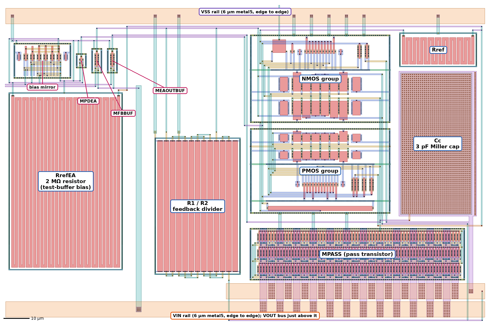

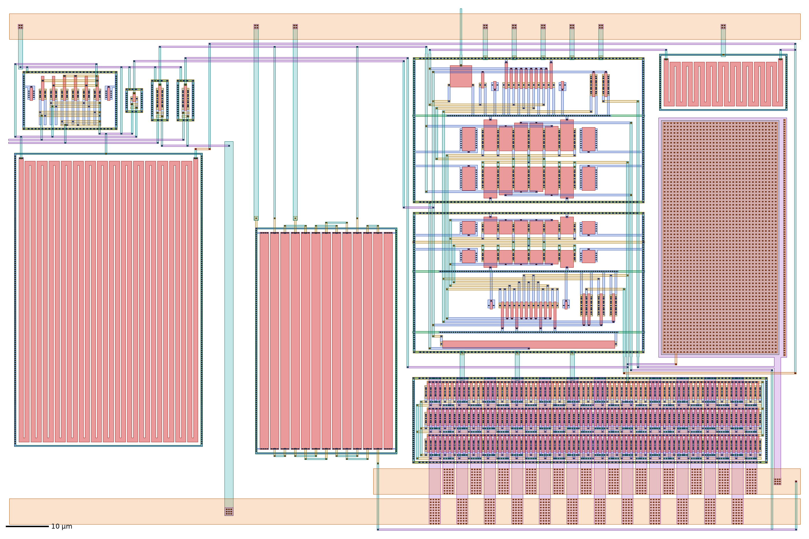

Colour key for all screenshots: green = diffusion (COMP), red = poly, blue = metal1,
amber = metal2, teal = metal3, purple = metal4, orange = metal5, grey = MIM top plate;
small dark squares are contacts and vias.

| Block | What it is | Size (µm) |
|---|---|---|
| NMOS group | input pair MIN1/MIN2, tail mirror MREF/MTAIL, MPDREF, level-shifter MN1/MN2, MENDISCHARGE — one p+ ring | 56.5 × 37.8 |
| PMOS group | mirror load MLOAD1/2, cascodes MCASC1/2, MENPASSOFF, level-shifter MP1/MP2, MBIASSW — one n-well and ring | 56.5 × 36.7 |
| MPASS | pass transistor, 630 µm / 0.55 µm as 3 rows × 70 fingers | 83.0 × 20.5 |
| Cc | 3 pF MIM Miller cap, 27.35 × 54.5 µm plate (as tall as the core column) | 29.8 × 55.7 |
| Rref | amplifier bias resistor | 30.0 × 13.5 |
| R1 / R2 | feedback divider, 13 interleaved unit resistors (D A A B A B A B A B A A D) | 33.2 × 57.4 |
| Test buffers | RrefEA (2 MΩ, 30 segments), bias mirror MREFEA/MBIASEA/MBIASFB, MPDEA, followers MFBBUF / MEAOUTBUF — not part of the LDO | 44 × 88 |

## 2. Floorplan

The core column holds the two transistor groups, 1.2 µm apart (the DRC minimum
between the NMOS ring and the PMOS n-well, found by a DRC sweep). Rref sits right
next to the tail mirror, Cc between the core and the pass-device gate, and the
pass device spans the core and Cc columns so EAOUT runs straight up into its gate
bar. R1/R2 sits beside the pass device with its VOUT end on the VOUT side. The test
buffers stand apart on the left, centred on the LDO.

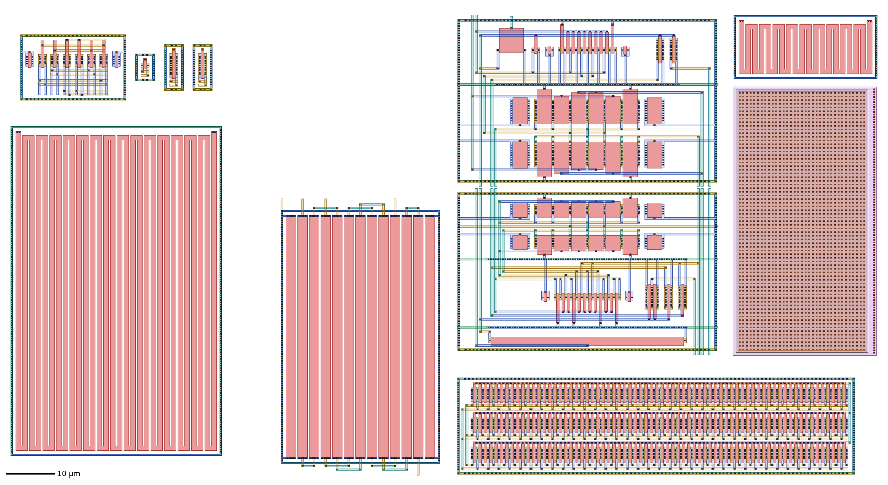

## 3. Device groups (shared rings, tap rows, diffusion sharing, common centroid)

Built by [core_groups.py](core_groups.py) with gLayout and converted to 6 V
devices (DUALGATE; V5_XTOR only around the L = 0.6 µm NMOS):

* **Diffusion sharing** — each row is one diffusion; devices with a common source
  (input pair: TAIL, tail mirror: VSS, mirror load: VIN) share strips.
* **2-D common centroid** — the long-channel pairs are folded into two rows,
  A B B A over B A A B: both devices have the same centroid in x and y, and each
  owns the end fingers of one row, so neither sees more edge than the other.
* **Dummies** — every matched row ends in two dummy fingers; the cascodes are
  separated by shared dummies (x A A x B B B B x A A x). Dummy gates are tied to the
  bulk (always off).
* **Shared rings + tap rows** — one ring per group; tap rows between rows instead
  of a ring per device.
* **Wiring inside the group** — gate side: poly contact onto metal1 tracks;
  source/drain side: metal1 strips up to metal2 tracks; bulk strips and dummy gates
  drop straight onto the facing tap row. The two rows of a folded pair face one
  shared source/drain channel (the cross-coupling); the lower row reaches it on
  metal1, the upper on metal3 so the two never short. Nets that leave a channel use
  metal3 risers placed beside the rows, never over a device; their left-to-right
  order is chosen to minimise crossings, and nets shared by both groups get the same
  column so the pins line up across the 1.2 µm gap.

Each group passes DRC and LVS on its own ([check_groups.py](check_groups.py)).

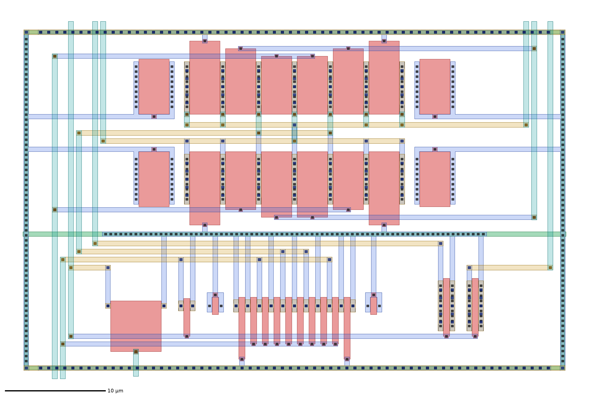

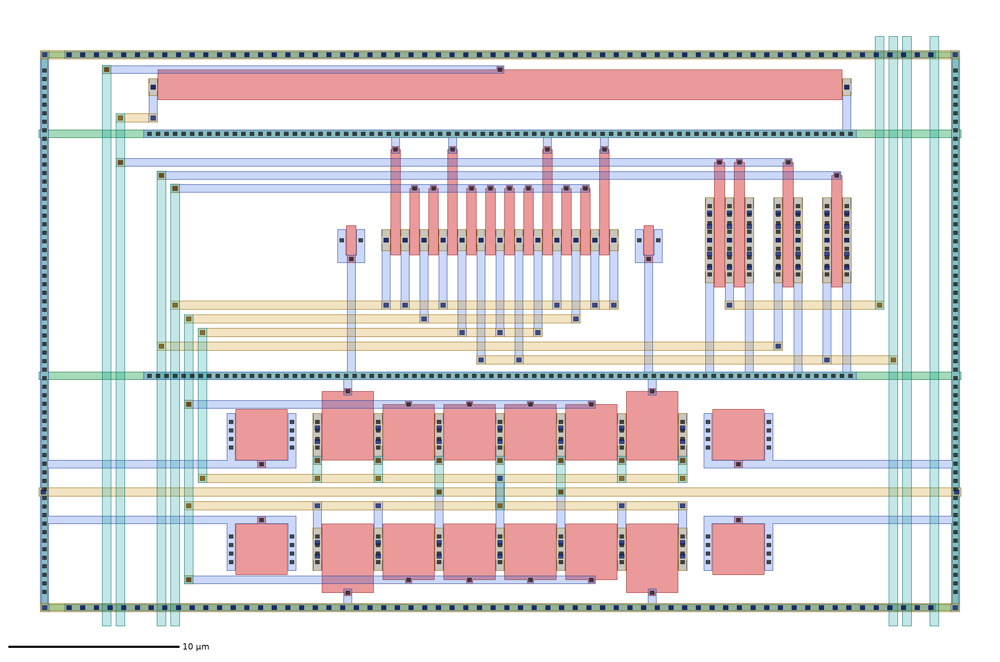

The input pair, folded into two rows (A B B A over B A A B) with two dummies per
end and the shared source / drain channel between the rows:

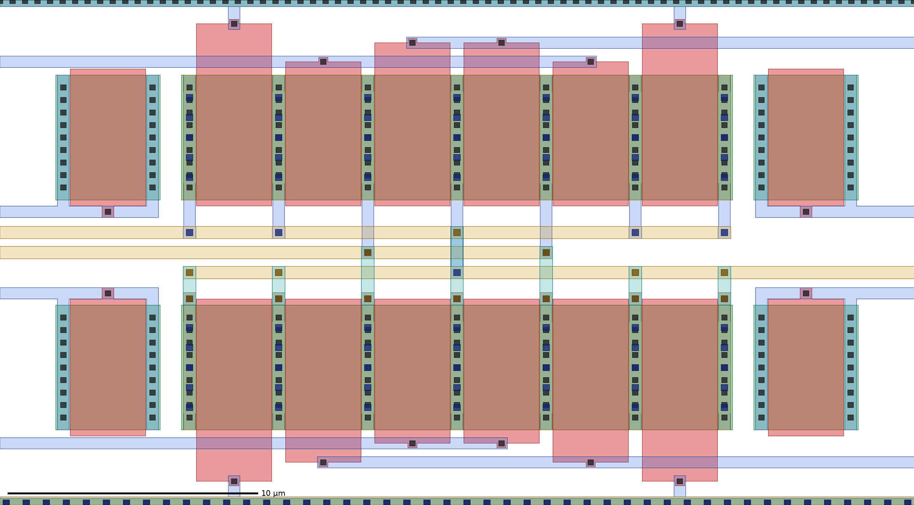

The riser bundle on the left of the core and the channel between R1/R2 and the core
(EAOUT and ENB_5V going down to the test buffers):

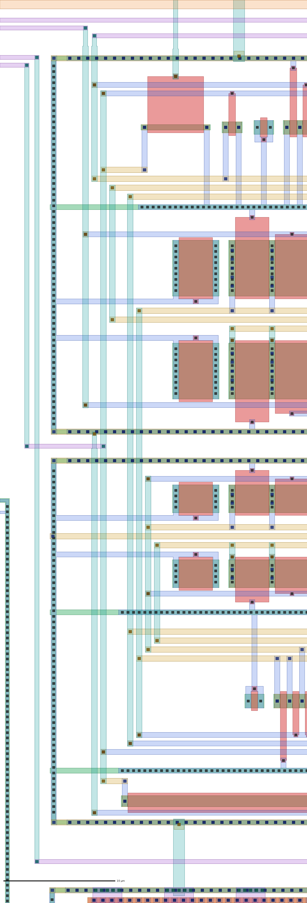

## 4. Block wiring

[route_v2.py](route_v2.py), on top of the placement:

* **Signals** — the six shared nets cross the group gap on straight metal3
  bridges; EAOUT goes straight up into the pass-device gate bar and across to Cc's
  top plate; FB and IREF use a channel under the core (FB to R1/R2, IREF to Rref);
  VIN_BIAS runs around Cc to Rref and along the bottom to RrefEA; MP1's VSS gate
  drops 1.2 µm onto the NMOS ring.
* **Cc** — every metal4 shape keeps 1.2 µm from the virtual bottom plate (MIMTM.1);
  the VOUT strap leaves the plate at a right angle; EAOUT reaches the top plate
  through the plate contact on metal5.
* **Power** — VIN and VSS rails are 6 µm metal5 edge to edge; the VOUT bus (6 µm)
  runs to the right edge (the VOUT pad side). The pass device is strapped as in v1:
  metal4 straps 2.6 µm wide on a 3.2 µm pitch, alternating VIN / VOUT, with via
  arrays on every row's bar. Power drops are 1 µm metal3 (2 µm to the test
  buffers) with via arrays.
* **Kelvin sense** — R1/R2's VOUT end does not touch the VOUT bus next to R1/R2: it
  runs on its own (metal3 up through the buses, metal4 along the top edge) and joins
  the bus at the VOUT pin, so the bus resistance is inside the regulation loop.
  Without it, load regulation was 0.36 % typical / 0.84 % worst; with it 0.27 % /
  0.75 %.
* **Ports** — VIN, VSS (left ends of the rails), VOUT (right end of the VOUT bus),
  VREF (pass-device edge), EN (VSS edge), FB_BUF and EAOUT_BUF (left edge).

Power grid (metal5 rails and buses, metal4 straps):

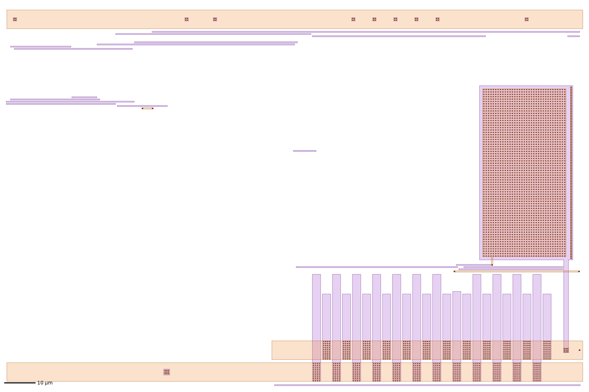

Signal routing (metal3 and metal4):

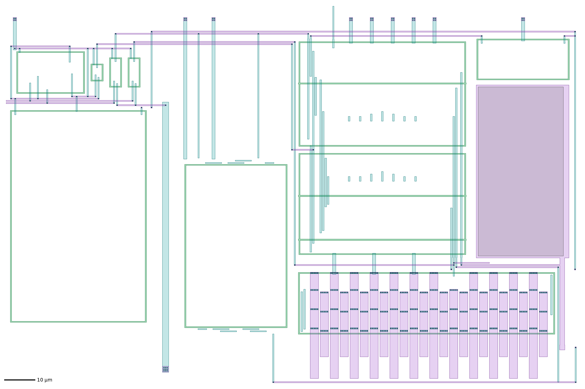

Pass device, straps and the VOUT / VIN buses:

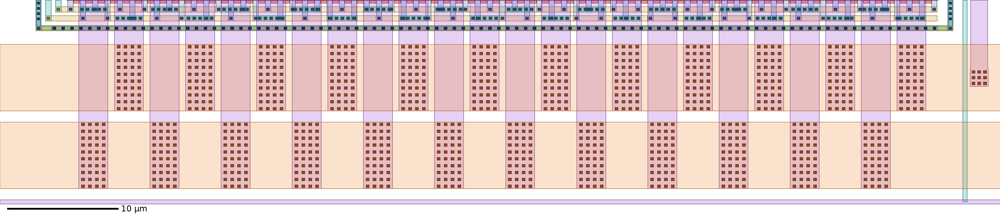

Cc, Rref and the channel under the pass device (EAOUT, VOUT, VREF, VIN_BIAS):

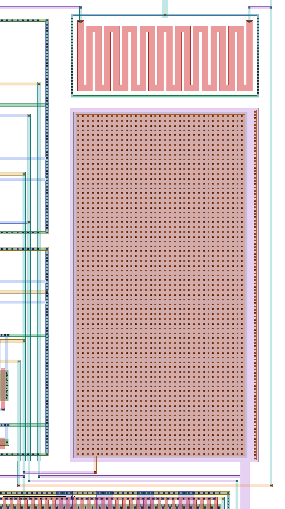

Test buffers (RrefEA, bias mirror, MPDEA, the two followers) and their channels:

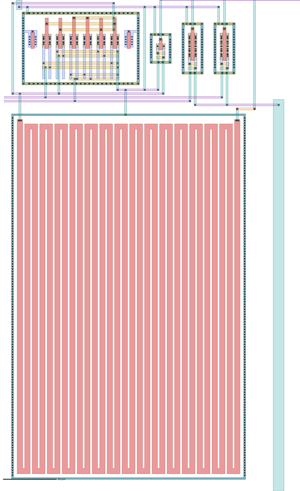

## 5. Verification

* **DRC** — official GF180MCU KLayout deck (gf180mcuD): clean. The whole-die
  density rules (Mx.4, MT.3, DCF.1b, PL.8) are met by the harness's chip-level fill.
* **LVS** — magic extraction against the schematic netlist with netgen: *Circuits
  match uniquely*, no property errors (28 devices, 18 nets after merging fingers).
  30 dummy devices (gate tied to the bulk, always off) are removed first.

## 6. Post-layout results

Extracted with magic ([pex/pex.tcl](pex/pex.tcl)) as a C-only and a full RC
netlist, simulated with the same testbenches as the schematic
(`simulations/run_sims.py --pex rc --layout v2 --corners`).

Typical corner, 27 °C, VIN = 5 V, CL = 2 pF:

| Parameter | Spec | Schematic | **v2, RC-extracted** |
|---|---|---|---|
| VOUT at 5 mA | 3.201–3.399 V | 3.3092 V | **3.3093 V** |
| Dropout at 10 mA | ≤ 300 mV | 152 mV | **162 mV** |
| Quiescent current | ≤ 100 µA | 60.0 µA | **59.8 µA** |
| Line regulation (4.5–5.5 V) | ≤ 1 % | 0.042 % | **0.042 %** |
| Load regulation (0–10 mA) | ≤ 1 % | 0.269 % | **0.271 %** |
| PSRR at 100 Hz | ≥ 40 dB | 59.0 dB | **59.0 dB** |
| PSRR at 10 kHz / 1 MHz | — | 43.9 / 5.2 dB | 43.4 / 4.5 dB |
| Load step 0 → 10 mA in 1 µs | — | −212 / +313 mV | −249 / +343 mV |
| Line step 5.0 → 4.5 V in 1 µs | — | −54 / +52 mV | −58 / +56 mV |
| EN turn-on | — | 1.66 µs | 1.74 µs |
| Shutdown current | — | 0.19 nA | 1.27 nA |

All 45 corners (MOS tt/ff/ss/fs/sf × resistor/cap typical/ff/ss × −40/27/110 °C):

| | Schematic | **v2, RC-extracted** | Spec |
|---|---|---|---|
| VOUT | 3.3078–3.3120 V | 3.3080–3.3123 V | 3.201–3.399 V |
| Quiescent current | 43.6–87.0 µA | 43.4–86.8 µA | ≤ 100 µA |
| Line regulation | ≤ 0.085 % | ≤ 0.084 % | ≤ 1 % |
| Load regulation | ≤ 0.736 % | ≤ 0.751 % | ≤ 1 % |
| Dropout at 10 mA | ≤ 262 mV | ≤ 273 mV | ≤ 300 mV |
| PSRR at 100 Hz | ≥ 52.6 dB | ≥ 52.7 dB | ≥ 40 dB |
| Shutdown current | ≤ 3.3 nA | ≤ 4.5 nA | — |

Full tables: [results_v2_pex_rc/summary.md](../simulations/results_v2_pex_rc/summary.md)
(C-only: [results_v2_pex_c/summary.md](../simulations/results_v2_pex_c/summary.md));
the plots are in the same folders.

### Loop stability

Loop broken at the MIN1 gate of the RC-extracted netlist
(`simulations/stability.py --pex rc --layout v2`); loads 0–10 mA, MOS corners,
−40/27/110 °C ([stability.md](../simulations/results_v2_pex_rc/stability.md)):

| CL | Worst-case PM | at | UGF range | Min GM |
|---|---|---|---|---|
| 2 pF | **64.4°** (schematic 70.6°, v1 layout 65.7°) | fs, 110 °C, 0 mA | 1.27–1.88 MHz | 12.6 dB |
| 50 pF | 26.1° (schematic 29.2°, v1 layout 26.9°) | fs, 110 °C, 0 mA | 0.75–1.88 MHz | 10.7 dB |

### EM / IR

[pex/emir_check.py](pex/emir_check.py): DC operating point of the RC-extracted
netlist at the full 10 mA load, against the GF180MCU design-manual limits
(section 14.2, DC, 110 °C):

| Element | Current density | Limit | |
|---|---|---|---|
| VIN / VOUT metal5 bus (6 µm), all the load current | 1.68 mA/µm | 2.2 | OK |
| Pass-device metal4 strap (12 VIN / 12 VOUT, +20 % imbalance) | 0.39 mA/µm | 1.0 | OK |
| via2 / via3 under each strap, each of the 3 rows (6 cuts) | 0.058 mA per via | 0.28 | OK |

IR drop (pin to the farthest point of the net): VIN 10.5 mV (its pin is at the far
left end of the edge-to-edge rail), VOUT 4.6 mV, VSS 0.8 mV.

## 7. Reproduce

```sh
cd layout
glpy core_groups.py gl            # device groups (gLayout environment)
python3 check_groups.py           # group DRC + LVS
python3 place_v2.py snug          # placement
python3 route_v2.py               # block wiring, DRC, LVS -> ldo_v2.gds
cd pex && magic -dnull -noconsole -rcfile $PDK_ROOT/gf180mcuD/libs.tech/magic/gf180mcuD.magicrc pex.tcl
python3 emir_check.py             # EM / IR
cd ../../simulations
python3 run_sims.py --pex rc --corners
python3 stability.py --pex rc
cd ../layout && python3 make_doc_images.py   # the pictures in this README
```

## 8. Open items

* **Slot wrapper** — the Chipalooza slot is not assigned yet. The harness pins were
  extracted for all 18 slots ([harness_slot_pins.json](harness_slot_pins.json)); the
  block is drawn so VIN / VSS line up with the harness's `vdd_5v0` / `vss_5v0`
  order. Final `slot_<N>.gds` once a slot is assigned.
* **Fill exclusion** — mark the input pair, Cc and R1/R2 with dummy-exclude layers
  before the chip-level fill runs.
