# Layout and Post-Layout Results

Physical design of the capless LDO and its verification on the extracted layout. The
schematic-only results are in [`../simulations/README.md`](../simulations/README.md).

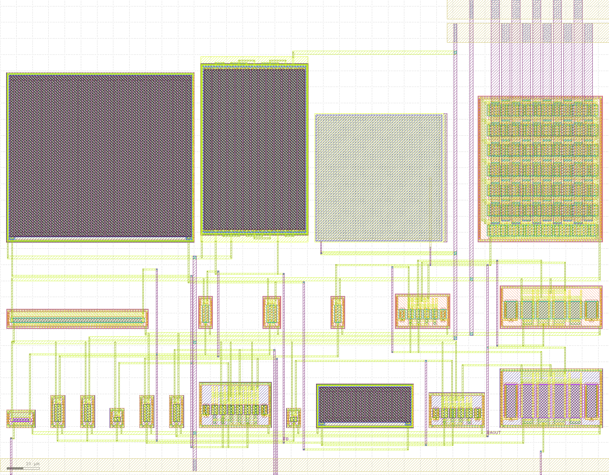

| Item | Result |
|---|---|
| Block size | **188.3 × 146.9 µm** (27,700 µm²); devices fill 40 % of it |
| DRC (official gf180mcuD KLayout deck) | **No geometry violations.** Only the block-level density checks (M1–M5.4, DCF.1b, MT.3, PL.8) are flagged; chip-level fill covers them. |
| DRC (magic) | 9 flags, all inside PDK cells and not flagged by the KLayout deck: 8 × PRES/LRES.4 in the generated snake resistors, 1 × MIMTM.2 at the MIM cap |
| LVS (netgen vs `netlist/schematic/ldo.spice`) | **Circuits match uniquely**, 31 = 31 devices, no property errors (dummy devices removed first, see below) |
| Post-layout simulation (RC extraction) | All specs pass at typical and at the worst corners |
| Post-layout stability | Phase margin ≥ 65.7° at every load and corner with 2 pF on VOUT |
| EM (GF180 DRM §14.2 limits, 110 °C) | All checked elements pass |
| IR drop at 10 mA | VIN 6.4 mV, VOUT 5.8 mV, VSS 1.0 mV |

## Pins

| Pin | Edge / layer | Notes |
|---|---|---|
| VIN | top, metal5 bus 6 µm wide | 5.0 V supply; connect anywhere along the bus |
| VOUT | top, metal5 bus 6 µm wide | 3.3 V output |
| VSS | bottom, metal5 bus 4 µm wide | ground |
| VREF | bottom edge, metal4 | 1.2 V reference input |
| EN | bottom edge, metal4 | 3.3 V logic enable (high = on) |
| FB_BUF, EAOUT_BUF | bottom edge, metal4 | test buffers (feedback node, error-amp output) |

## Floorplan

Three rows, arranged by signal flow. The amplifier column runs up the right-hand side,
directly under the Miller cap and the pass device.

| Row | Contents (left → right) |
|---|---|
| Top | RrefEA (buffer bias, 2 MΩ) · R1/R2 feedback-divider array · Miller cap Cc (3 pF MIM) · routing corridor · pass device |
| Middle (PMOS) | level shifter (MP1, MP2) · bias switch MBIASSW · EAOUT pull-up MENPASSOFF · cascodes MCASC1/2 · mirror load MLOAD1/2 |
| Bottom (NMOS) | level shifter MN1/MN2 · enable pulldowns · test buffers · buffer-bias mirror · MPDREF · Rref · tail mirror MREF/MTAIL · input pair MIN1/2 |

- Cc sits right next to the pass device, so EAOUT (error-amp output → Cc → pass gates) and
  VOUT are short.
- Rref sits between its pulldown and the tail mirror it biases.
- The middle and bottom rows are spread across the full width. The gaps between devices are
  the corridors for the vertical wires.

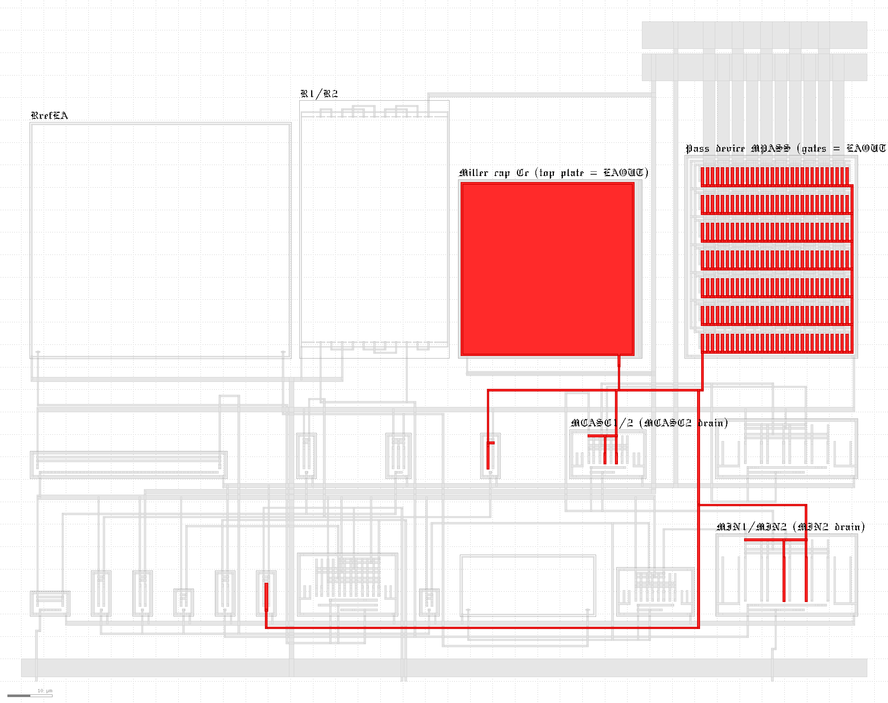

*The EAOUT net (red), traced from the layout: pass-device gates, Cc top plate, MCASC2 and MIN2
drains, MENPASSOFF, and the EAOUT_BUF follower gate.*

## Devices

- **Transistors** come from [gLayout](https://github.com/ReaLLMASIC/gLayout) (`gl_devices.py`).
  gLayout's GF180 setup only draws 3.3 V devices. Adding the DUALGATE (55/0) marker makes them
  `pfet_06v0` / `nfet_06v0`, plus V5_XTOR (112/1) for the L = 0.6 µm `nfet_05v0`. Each converted
  device was checked with the KLayout deck and with magic extraction.
- **Poly resistors and the MIM cap** come from the PDK's magic generator. Snake segment lengths
  are pre-compensated for magic's bend extraction, so the extracted r_length matches the
  schematic.
- **Pass device:** one block of 7 rows × 30 fingers × 3 µm (W = 630 µm, L = 0.55 µm) in a single
  guard ring.

### Matching

| Group | Arrangement | Why it matters |
|---|---|---|
| Input pair MIN1/MIN2 | dummy **A B B A** dummy, 2 × 10 µm fingers each | Mismatch becomes offset, × 2.75 into VOUT |
| Mirror load MLOAD1/2 | dummy A B B A dummy | Current mismatch becomes offset |
| Cascodes MCASC1/2 | dummy A B B A dummy | Symmetry of the error amp |
| Tail mirror MREF/MTAIL | dummy A B B A dummy | Amplifier bias current |
| Buffer bias mirror MREFEA → MBIASEA, MBIASFB | dummy **B A C C A B** dummy | Three devices on one centroid |
| Feedback divider R1/R2 | D **A A B A B A B A B A A** D: 7 + 4 identical 2 × 49.33 µm units | The ratio sets VOUT. Both resistors centre on the same unit, and the ratio is exactly 7 : 4 whatever the sheet resistance. |

Common centroid cancels linear gradients along the row. Each matched group sits in one row at
one height, so vertical gradients (for example heat from the pass device above) affect both
halves equally. Dummy fingers are tied to the bulk.

### Input pair MIN1 / MIN2

Dummy – A – B – B – A – dummy: four 10 µm fingers between two dummies, all in one guard ring.

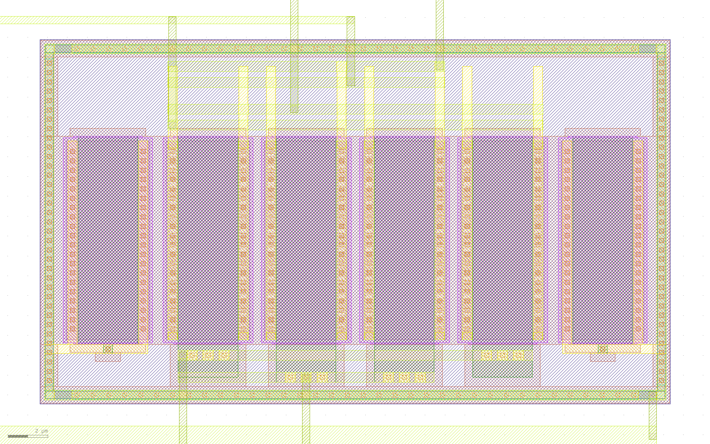

### Mirror load MLOAD1 / MLOAD2

Same A B B A pattern for the PMOS current-mirror load.

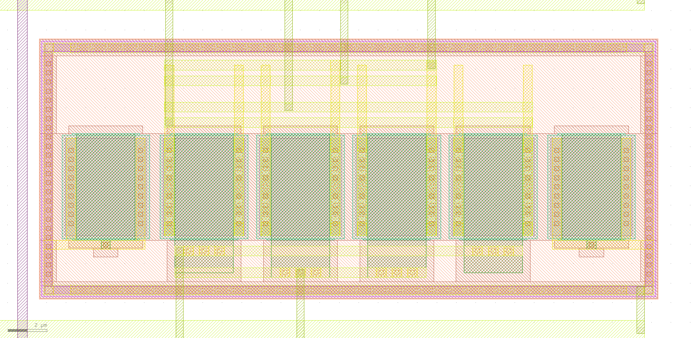

### Buffer bias mirror (three devices)

B A C C A B: the diode device MREFEA (A) and its two mirror outputs MBIASEA (B) and MBIASFB (C)
all share the same centroid.

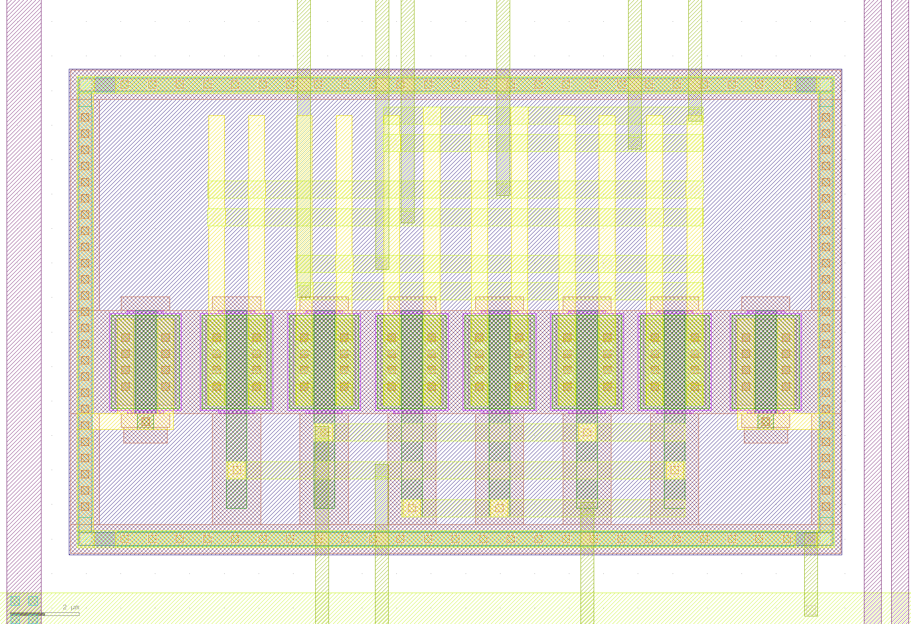

### Feedback divider R1 / R2

Thirteen identical poly strips: dummy, 7 × R1 and 4 × R2 interleaved symmetrically, dummy. The
metal straps above and below chain each resistor's units in series.

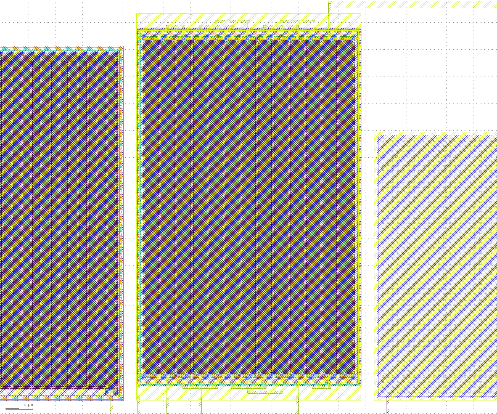

## Routing and power

- **Terminals:** each one leaves its device on a metal3 stub, gates on one side and
  source/drain on the other.
- **Channels:** between rows, every net has its own metal2 track. A constraint graph orders the
  tracks so stubs of different nets never cross.
- **Vertical wires:** nets that span rows, or reach a pin or bus, use a metal4 trunk placed
  near the middle of its own connections.
- **Keep-outs:** trunks stay off every device and keep 1.2 µm from the MIM cap. **Nothing is
  routed over the resistors, the capacitor or any transistor** except a device's own terminal
  connections.
- **Pass device power:** ten 2.6 µm metal4 straps (alternating VIN / VOUT) rise from every row's
  source and drain bars to the metal5 buses. Each strap meets each row through 5 via2 + 5 via3
  cuts.
- **VIN / VOUT trunks:** the trunks from the rest of the circuit reach the buses through a
  corridor between Cc and the pass device.

### Pass device, straps and power buses

The 7-row pass device (bottom) with its ten metal4 straps rising to the two metal5 buses at the
top: alternating VIN and VOUT.

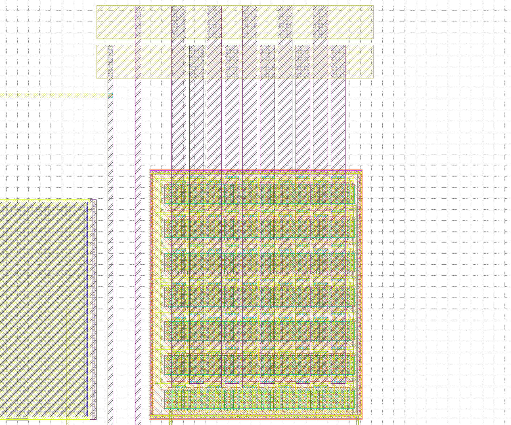

### VIN, VOUT and EAOUT around the cap and pass device

Traced from the layout: VIN in blue, VOUT in green, EAOUT in red. The two vertical wires in the
gap between the cap and the pass device are the VOUT (left) and VIN (right) trunks. EAOUT is the
cap's top plate, the pass-device gate comb and the thin wires below them.

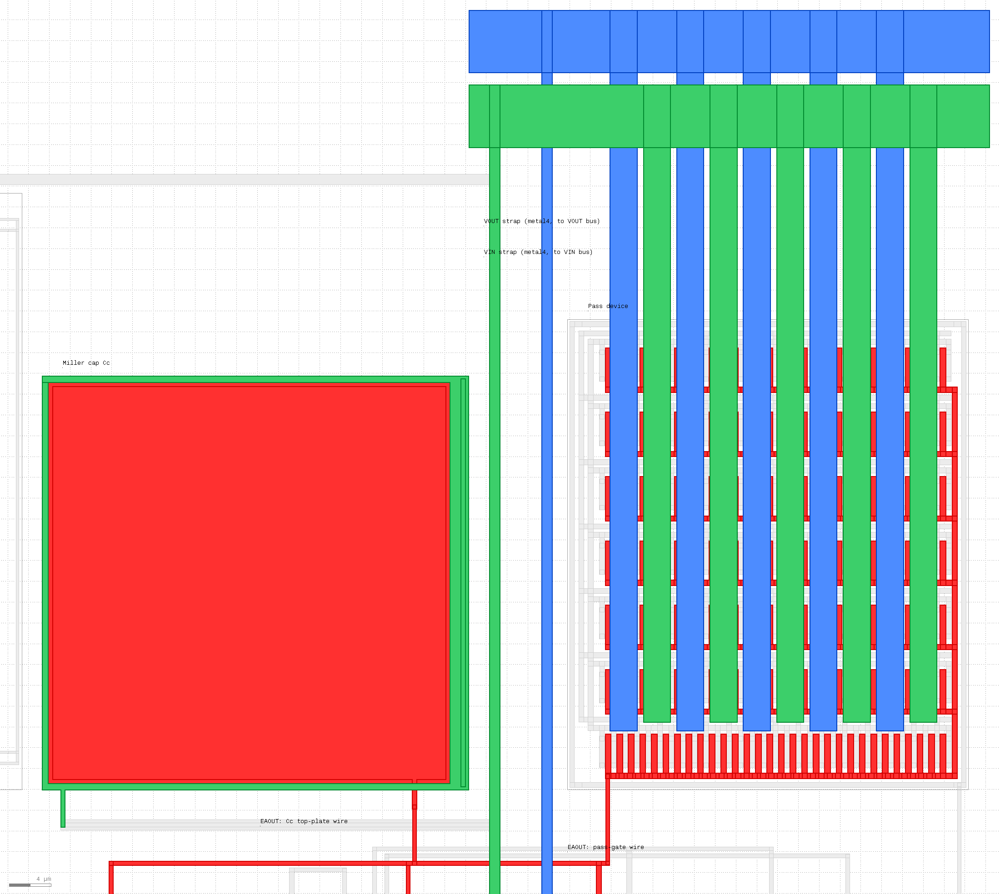

## Parasitic extraction

`pex/pex.tcl` (magic) extracts a flattened copy of the layout twice:

- **C-only** (`pex/ldo_pex_c.spice`): devices + wire capacitance to substrate + wire-to-wire coupling.
- **RC** (`pex/ldo_pex_rc.spice`): additionally splits 16 nets, including all power nets, into
  ≈ 6,000 resistor segments (`extresist`, simplification off so VOUT is included).

Wire capacitance on the key nets (C-only extraction):

| Net | Total | To other signals | Notes |
|---|---|---|---|
| EAOUT | 214 fF | 177 fF | Mostly coupling to VIN/VOUT inside the pass device (gate bars beside the source/drain bars). The gate-to-drain part adds to Cc. |
| FB | 32 fF | 18 fF | Feedback node kept short and off the resistors |
| VOUT | 316 fF | 276 fF | Low-impedance node |
| VREF | 9.6 fF | 3.7 fF | |
| FB_BUF / EAOUT_BUF | 21 / 19 fF | | |

## Post-layout simulation

`simulations/run_sims.py --pex c|rc` replaces the schematic LDO in all nine testbenches with
the extracted netlist (same stimuli and metrics). Typical corner, 27 °C:

| Parameter | Spec | Schematic | Layout (C) | Layout (RC) |
|---|---|---|---|---|
| Output voltage (5 mA) | 3.201 – 3.399 V | 3.3092 V | 3.3091 V | 3.3083 V |
| Dropout (10 mA) | ≤ 300 mV | 152 mV | 152 mV | **163 mV** |
| Quiescent current | ≤ 100 µA | 60.0 µA | 59.7 µA | 59.7 µA |
| Line regulation | ≤ 1 % | 0.042 % | 0.042 % | 0.038 % |
| Load regulation | ≤ 1 % | 0.269 % | 0.269 % | 0.276 % |
| PSRR at 100 Hz | ≥ 40 dB | 59.0 dB | 59.0 dB | 59.9 dB |
| PSRR at 10 kHz / 1 MHz | – | 44.0 / 5.2 dB | 43.7 / 4.9 dB | 43.3 / 4.5 dB |
| Load step 0 → 10 mA (1 µs) | – | −212 / +313 mV | −234 / +329 mV | −244 / +340 mV |
| Line step 5.0 → 4.5 V (1 µs) | – | −54 / +52 mV | −56 / +53 mV | −59 / +56 mV |
| EN turn-on time | – | 1.65 µs | 1.73 µs | 1.74 µs |
| EN threshold | 3.3 V logic | 1.39 / 1.58 V | 1.39 / 1.58 V | 1.39 / 1.58 V |
| Shutdown current | – | 0.19 nA | 1.22 nA | 1.22 nA |

- **Wire capacitance** (mostly on EAOUT) slows the loop slightly, so the load step grows by
  ≈ 30 mV.
- **Wire resistance** in the VIN → pass device → VOUT path adds 11 mV of dropout at 10 mA.
- **Junction leakage** of the tap and dummy diffusions raises the shutdown current to ≈ 1 nA.

RC netlist at the worst corners (110 °C), schematic value in brackets:

| MOS / R-C corner | Dropout (≤ 300 mV) | Load reg (≤ 1 %) | PSRR at 100 Hz (≥ 40 dB) | Iq (≤ 100 µA) | VOUT at 5 mA |
|---|---|---|---|---|---|
| ss / ss | **274 mV** (262) | 0.356 % (0.349) | 63.9 dB | 50.8 µA | 3.3084 V |
| ss / ff | 273 mV (261) | 0.392 % (0.385) | 62.8 dB | 73.3 µA | 3.3100 V |
| ff / ss | 179 mV (168) | 0.472 % (0.464) | 56.1 dB | 60.2 µA | 3.3075 V |
| ff / ff | 178 mV (166) | **0.748 %** (0.736) | 53.9 dB | 86.6 µA | 3.3093 V |

The tightest margin is dropout at slow corners and 110 °C: 274 mV, 26 mV inside the spec.

### Post-layout plots (RC-extracted layout, typical corner)

The same tests as the schematic plots in [`../simulations/README.md`](../simulations/README.md),
run on the extracted layout netlist. Each plot has its test conditions underneath.

#### Load regulation (0.276 %)

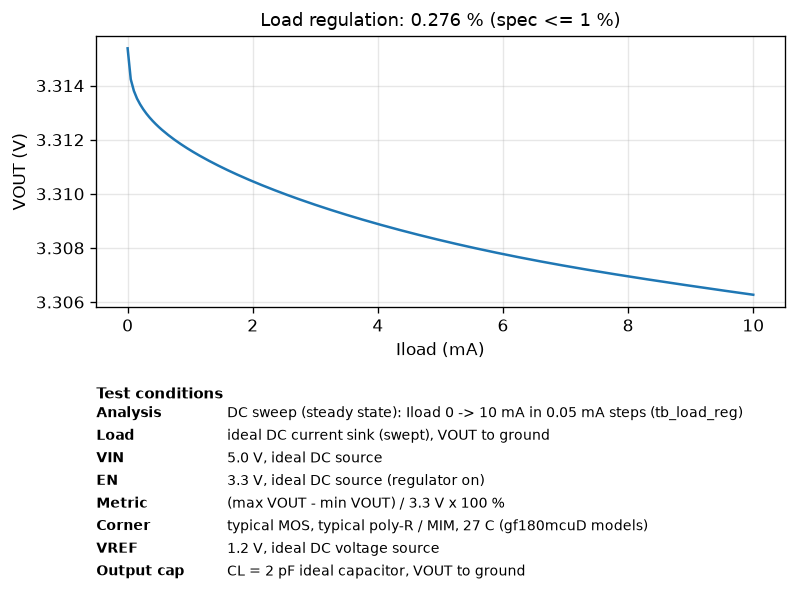

#### Line regulation (0.038 %)

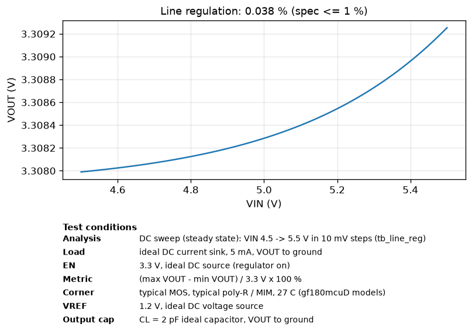

#### Dropout (163 mV at 10 mA)

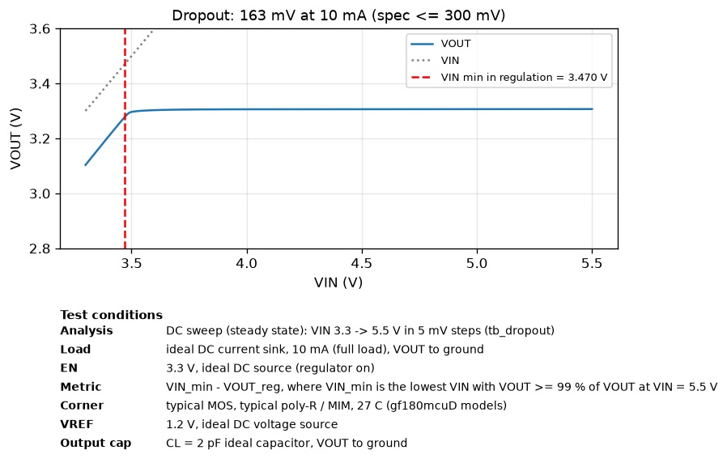

#### PSRR (59.9 dB at 100 Hz)

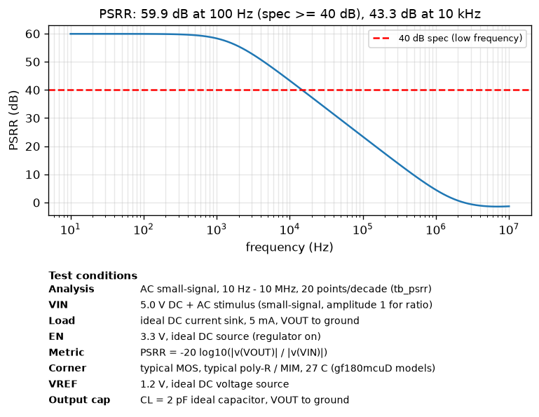

#### Load transient (−244 / +340 mV)

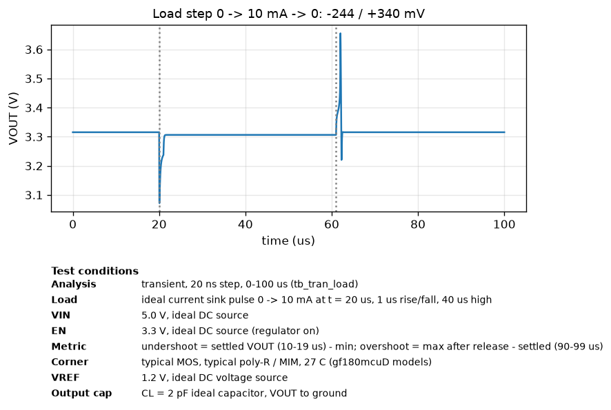

#### Line transient (−59 / +56 mV)

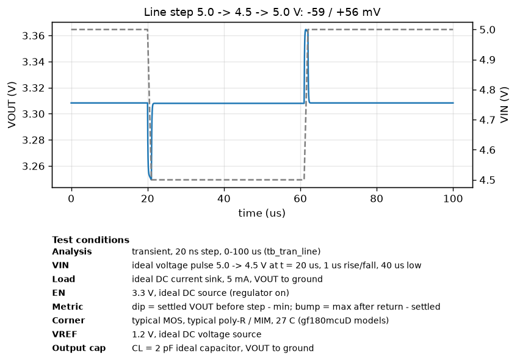

#### Enable turn-on (1.74 µs)

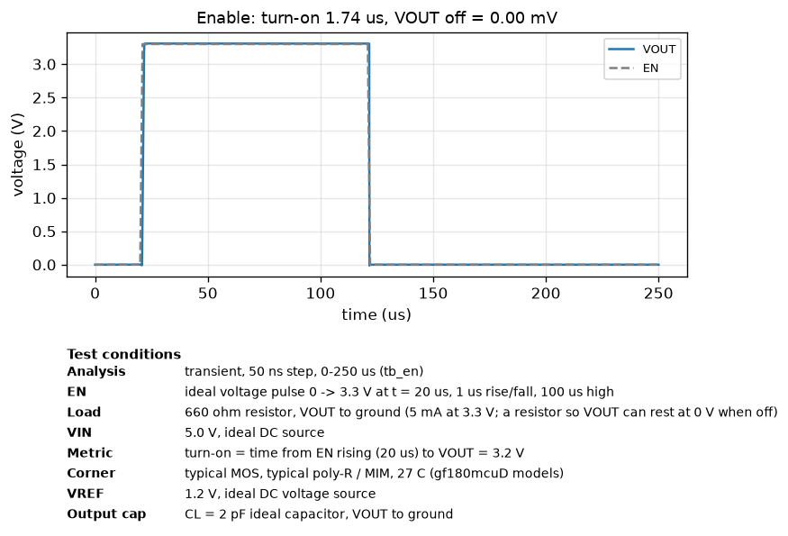

#### Enable threshold

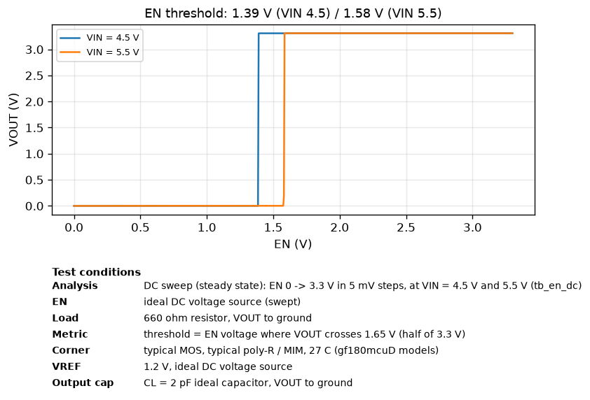

#### Quiescent and shutdown current (59.7 µA / 1.22 nA)

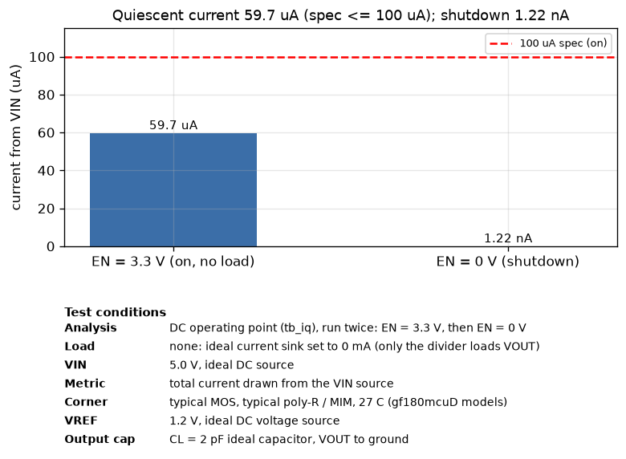

### Post-layout stability

Same method as the schematic analysis (`simulations/stability.py --pex rc`): the loop is opened
for AC at the gates of the MIN1 fingers inside the RC-extracted netlist. Sweep: 0–10 mA ×
5 MOS corners × −40 / 27 / 110 °C × 2 pF and 50 pF on VOUT (210 cases).

| Output capacitance | Worst phase margin (layout) | Schematic | Where | UGF range | Min gain margin |
|---|---|---|---|---|---|
| 2 pF | **65.7°** | 70.6° | fs, 110 °C, no load | 1.27 – 1.88 MHz | 12.8 dB |
| 50 pF | 26.9° | 29.2° | fs, 110 °C, no load | 0.75 – 1.88 MHz | 11.9 dB |

Typical corner, 27 °C, 2 pF: phase margin 68.7° at no load, rising to 84.5° at 10 mA. UGF is
about 1.55 MHz and the low-frequency loop gain 69–77 dB. The extra ≈ 210 fF of wiring on EAOUT
costs about 5° against the schematic.

Phase margin against output capacitance at the worst corner (fs, 110 °C), layout:

| Load | 2 pF | 5 pF | 10 pF | 15 pF | 20 pF | 30 pF | 50 pF | 100 pF | 200 pF |
|---|---|---|---|---|---|---|---|---|---|
| 0 (no load) | 66° | 58° | 49° | 43° | 39° | 33° | 27° | 20° | 16° |
| 10 µA | 73° | 68° | 61° | 55° | 50° | 44° | 36° | 27° | 20° |
| 100 µA | 81° | 80° | 78° | 75° | 73° | 69° | 62° | 50° | 38° |

**Maximum output capacitance for ≥ 45° phase margin (layout):**

| Load current | Max C_out |
|---|---|
| 0 (no load) | ≈ 12 pF |
| ≥ 10 µA | ≈ 28 pF |
| ≥ 100 µA | ≈ 100 pF |

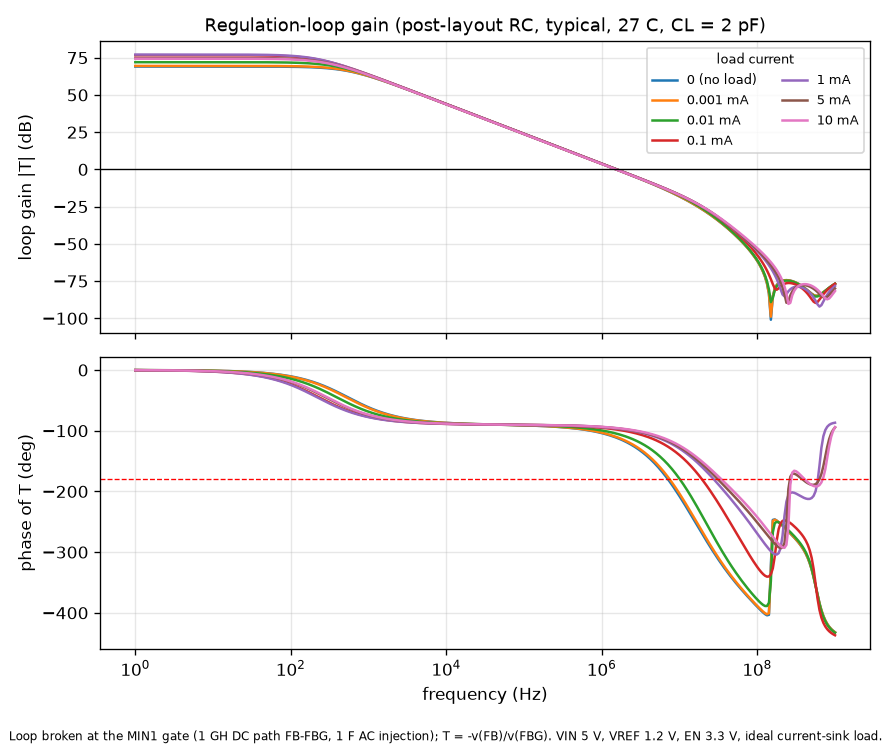

## EM / IR

`pex/emir_check.py` simulates the RC netlist at the worst current condition (VIN = 5 V, EN on,
10 mA load). It reads the voltage at every node of the VIN, VOUT and VSS resistor networks
(IR drop) and checks currents against the GF180MCU design-manual limits
([DRM §14.2](https://gf180mcu-pdk.readthedocs.io/en/latest/physical_verification/design_manual/drm_14_2.html),
DC, 110 °C): metal 1–4 1.0 mA/µm, metal 5 (11 kÅ) 2.2 mA/µm, 0.28 mA per via. Strap currents
assume an even split between the 10 straps plus 20 % margin. Via counts are taken from the GDS.

| Check | First layout | Final layout | Limit |
|---|---|---|---|
| IR drop VIN / VOUT / VSS at 10 mA | 25.4 / 24.5 / 1.0 mV | **6.4 / 5.8 / 1.0 mV** | – |
| VOUT at the pin, 10 mA | 3.2923 V | **3.3063 V** | – |
| Metal5 VIN/VOUT bus | 2.51 mA/µm (4 µm) ✗ | **1.68 mA/µm** (6 µm) ✓ | 2.2 mA/µm |
| Pass-device strap, metal4 | 1.61 mA/µm (1.5 µm) ✗ | **0.93 mA/µm** (2.6 µm) ✓ | 1.0 mA/µm |
| Via2/via3 per strap per row | 0.345 mA (1 cut) ✗ | **0.069 mA** (5 cuts) ✓ | 0.28 mA |

Fixes: the VIN/VOUT buses were widened to 6 µm and shortened to the pass-device corner, so the
pins sit next to the pass device and the feedback sense point. The straps were widened to
2.6 µm, and via arrays replaced the single via stacks.

## Known limitations

- **Output capacitance.** Stable with ≥ 45° phase margin (post-layout, worst corner) up to
  ≈ 12 pF on VOUT at no load, ≈ 28 pF at ≥ 10 µA and ≈ 100 pF at ≥ 100 µA. See
  [Post-layout stability](#post-layout-stability).
- **Fast load edges.** A 10 mA step with 10 ns edges dips VOUT by ≈ 1 V (capless design, loop
  response ≈ 1 µs). Loads with fast current edges need their own decoupling.
- **EM check method.** It is analytic, from simulated currents, not a full per-segment sign-off.
- **Corner coverage.** Post-layout corners cover the four extreme MOS × R/C combinations at
  110 °C, not all 45.
- **Not yet done.** Harness slot wrapper and pad connections.

## Files and reproducing

| Path | Contents |
|---|---|
| `build_layout.py` | Generates the whole layout: devices, placement, routing, DRC, extraction, LVS |
| `gl_devices.py` | gLayout transistor generation and 5/6 V conversion (gLayout Python environment) |
| `mag/`, `gds/ldo.gds` | Layout (magic cells) and GDS |
| `lvs/` | Extracted netlist, LVS netlist (dummies removed) and netgen report `comp.out` |
| `drc.txt` | magic DRC report |
| `pex/` | Extraction script, C / RC netlists, EM/IR check |
| `doc/` | Images used in this file |

```sh
cd layout
python3 build_layout.py              # layout + DRC + LVS (needs gLayout: GLAYOUT_PYTHON)
cd pex && magic -dnull -noconsole -rcfile $PDK_ROOT/gf180mcuD/libs.tech/magic/gf180mcuD.magicrc pex.tcl
python3 emir_check.py                # IR drop and EM
cd ../../simulations
python3 run_sims.py --pex rc         # post-layout spec tests -> results_pex_rc/
python3 stability.py --pex rc        # post-layout loop gain  -> results_pex_rc/stability.*
```
