# Schematic Simulation Results

Pre-layout verification of the capless LDO (`xschem/ldo.sch`): 5.0 V in, 3.3 V out,
0–10 mA, GF180MCU (gf180mcuD) 5/6 V devices. Everything here simulates the
**schematic**, with ideal wiring. The post-layout results (extracted parasitics, EM/IR)
are in [`../layout/README.md`](../layout/README.md).

## Circuit

`xschem/ldo.sch`. Signal path: the feedback divider R1/R2 senses VOUT and gives FB. The error
amplifier compares FB with VREF; it is the NMOS input pair MIN1/MIN2 with tail current MTAIL,
cascodes MCASC1/2 and the PMOS mirror load MLOAD1/2. Its output EAOUT drives the gate of the
PMOS pass device MPASS. The Miller capacitor Cc (EAOUT to VOUT) sets the loop's dominant pole.
Rref and MREF set the amplifier bias. MFBBUF and MEAOUTBUF are source-follower test buffers for
FB and EAOUT. MENPASSOFF, MENDISCHARGE, MBIASSW and the pulldowns turn everything off when EN is
low.

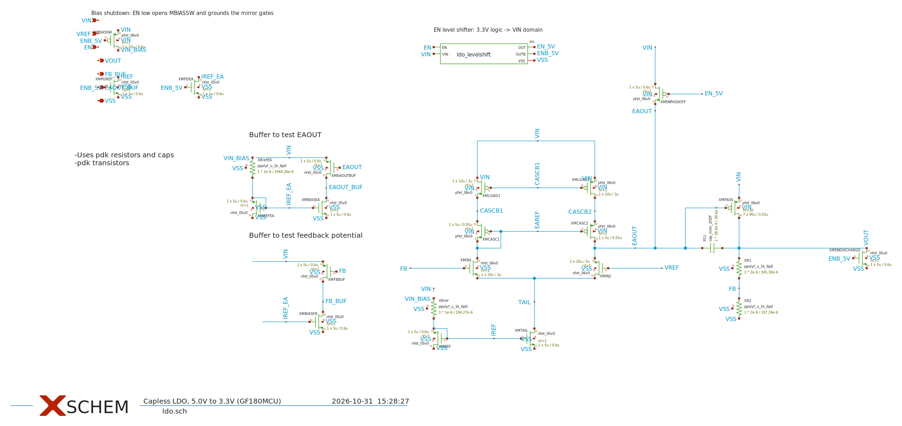

The EN level shifter (`xschem/ldo_levelshift.sch`) translates the 3.3 V harness logic to the
5 V VIN domain:

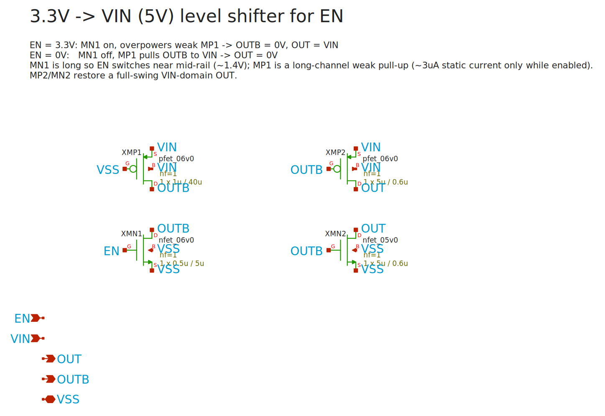

## Summary

| Parameter | Spec | Typical (27 °C) | Worst of 45 corners | Result |
|---|---|---|---|---|
| Output voltage (5 mA) | 3.201 – 3.399 V | 3.3092 V | 3.3078 – 3.3120 V | PASS |
| Dropout (10 mA) | ≤ 300 mV | 152 mV | 262 mV (ss, 110 °C) | PASS |
| Quiescent current (no load) | ≤ 100 µA | 60.0 µA | 87.0 µA (ff, ff R/C, 110 °C) | PASS |
| Line regulation (4.5–5.5 V, 5 mA) | ≤ 1 % | 0.042 % | 0.085 % | PASS |
| Load regulation (0–10 mA) | ≤ 1 % | 0.269 % | 0.736 % (ff, ff R/C, 110 °C) | PASS |
| PSRR at 100 Hz (5 mA) | ≥ 40 dB | 59.0 dB | 52.6 dB (sf, ff R/C, 110 °C) | PASS |
| Phase margin (C_out = 2 pF, 0–10 mA) | ≥ 45° | 86° (5 mA) | 70.6° (fs, 110 °C, no load) | PASS |
| EN off → VOUT | 0 V | 0.00 mV | – | PASS |
| Shutdown current (EN = 0) | – | 0.19 nA | 3.3 nA (ff, 110 °C) | info |
| PSRR at 10 kHz / 1 MHz | – | 44.0 / 5.2 dB | – | info |
| Load step 0 → 10 mA (1 µs edges) | – | −212 / +313 mV | – | info |
| Line step 5.0 → 4.5 V (1 µs edges) | – | −54 / +52 mV | – | info |
| EN turn-on time (to 3.2 V) | – | 1.65 µs | – | info |
| EN switching threshold | 3.3 V logic | 1.39 / 1.58 V at VIN 4.5 / 5.5 V | – | PASS |

Corners: 5 MOS corners (tt, ff, ss, fs, sf) × 3 poly-resistor / MIM-cap corners
(typical, ff, ss) × −40 / 27 / 110 °C = 45 combinations, all passing. The full table is in
[`results/summary.md`](results/summary.md).

## How each test is run

All testbenches are xschem schematics in this folder (`tb_*.sch`). Each one instantiates
`xschem/ldo.sym` and drives it with ideal sources:

| Common condition | Value |
|---|---|
| VIN | 5.0 V ideal DC source (unless swept) |
| VREF | 1.2 V ideal DC source |
| EN | 3.3 V ideal DC source (regulator on), the harness logic level |
| Load | ideal DC current sink from VOUT to ground; the EN tests use a 660 Ω resistor so VOUT can rest at 0 V when off |
| Output capacitance | 2 pF ideal capacitor (on-chip load / routing) |
| Models | gf180mcuD `sm141064.ngspice`: typical MOS, typical poly-resistor and MIM corners, 27 °C |

| Testbench | Analysis | Stimulus | Metric |
|---|---|---|---|
| `tb_load_reg` | DC sweep | load 0 → 10 mA, 0.05 mA steps | (max VOUT − min VOUT) / 3.3 V |
| `tb_line_reg` | DC sweep | VIN 4.5 → 5.5 V, 10 mV steps, 5 mA load | (max VOUT − min VOUT) / 3.3 V |
| `tb_dropout` | DC sweep | VIN 3.3 → 5.5 V, 10 mA load | VIN_min − VOUT, VIN_min = lowest VIN with VOUT ≥ 99 % of its regulated value |
| `tb_psrr` | AC | small-signal on VIN, 10 Hz – 10 MHz, 5 mA load | −20 log10 \|v(VOUT) / v(VIN)\| |
| `tb_tran_load` | transient | load 0 → 10 mA → 0, 1 µs edges | dip / overshoot against the settled VOUT |
| `tb_tran_line` | transient | VIN 5.0 → 4.5 → 5.0 V, 1 µs edges, 5 mA | dip / bump against the settled VOUT |
| `tb_en` | transient | EN 0 → 3.3 V → 0, 660 Ω load | time from EN rising to VOUT = 3.2 V; VOUT when off |
| `tb_en_dc` | DC sweep | EN 0 → 3.3 V at VIN 4.5 and 5.5 V, 660 Ω load | EN voltage where VOUT crosses 1.65 V |
| `tb_iq` | operating point | no load, EN = 3.3 V then 0 V | current from VIN; test-buffer levels |
| `stability.py` | AC loop gain | loop opened at the input-pair gate (see below) | unity-gain frequency, phase margin, gain margin |

Every result plot carries a "Test conditions" panel with the exact load, sweep and metric.

## Results

Each plot below is shown at full width. Every plot has a "Test conditions" panel under the
graph with the exact load, sweep and metric.

### Load regulation

VOUT while the load current is swept from 0 to 10 mA (ideal current sink, VIN = 5.0 V).
Result: 0.269 % (spec ≤ 1 %).

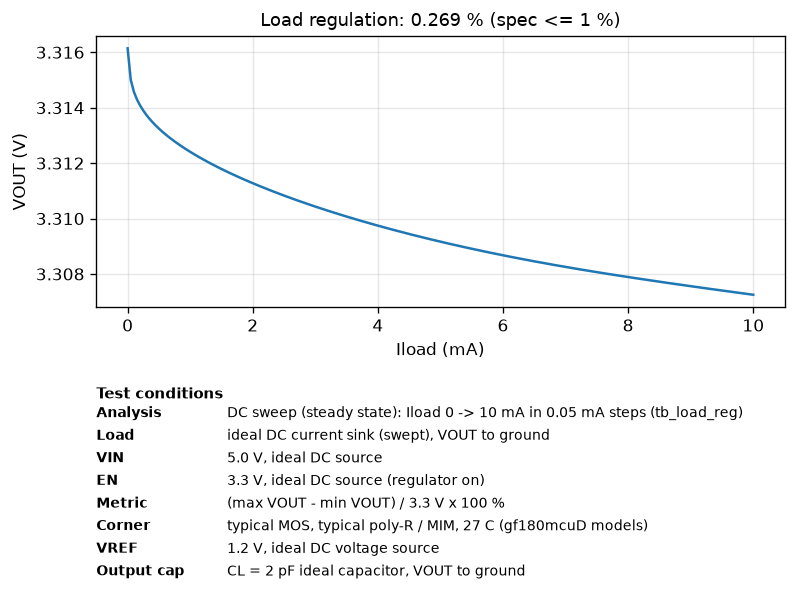

### Line regulation

VOUT while VIN is swept from 4.5 to 5.5 V at a 5 mA load. Result: 0.042 % (spec ≤ 1 %).

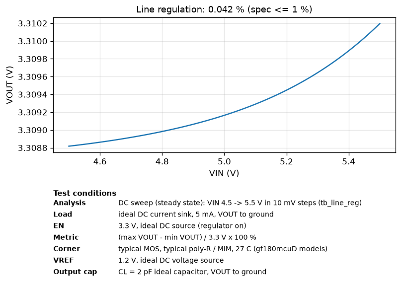

### Dropout

VOUT (and VIN) while VIN is swept from 3.3 to 5.5 V at the full 10 mA load. Dropout is how far
VIN can fall toward VOUT before regulation is lost. Result: 152 mV (spec ≤ 300 mV).

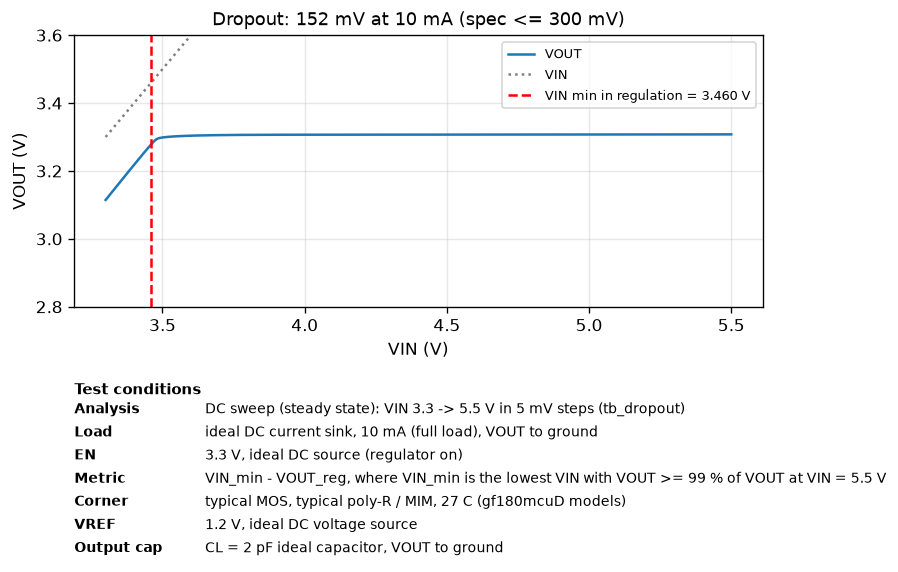

### Power-supply rejection (PSRR)

How much of a ripple on VIN reaches VOUT, from 10 Hz to 10 MHz at a 5 mA load. Higher is
better. Result: 59.0 dB at 100 Hz (spec ≥ 40 dB). It falls at high frequency, where the loop
runs out of gain.

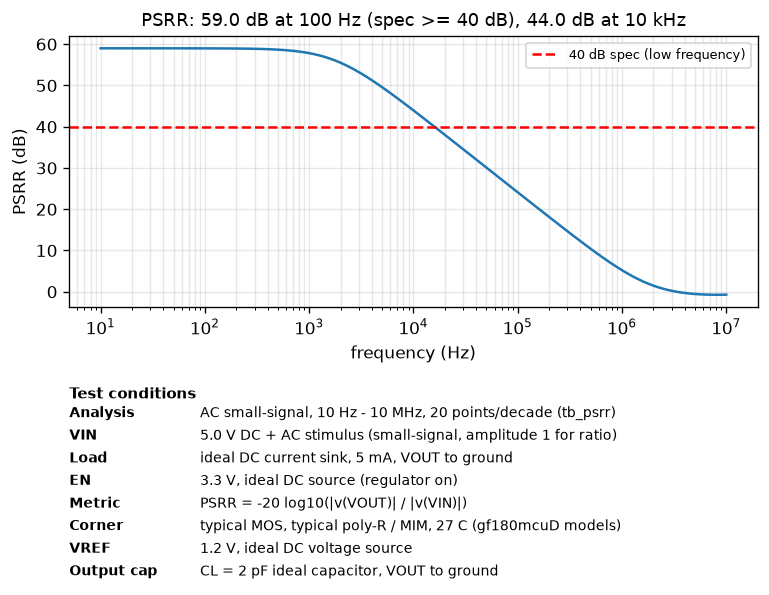

### Load transient

VOUT when the load steps 0 → 10 mA → 0 with 1 µs edges. Result: −212 mV dip on the step up,
+313 mV overshoot on the step down, settling within a few µs.

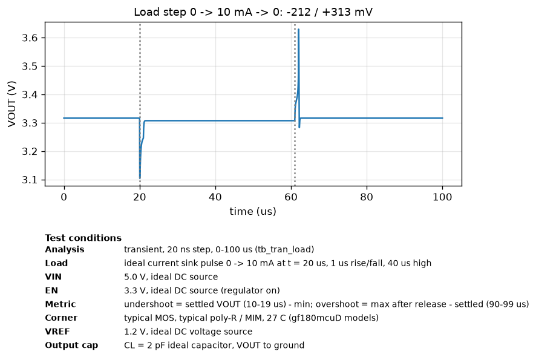

### Line transient

VOUT when VIN steps 5.0 → 4.5 → 5.0 V with 1 µs edges at 5 mA. Result: −54 / +52 mV.

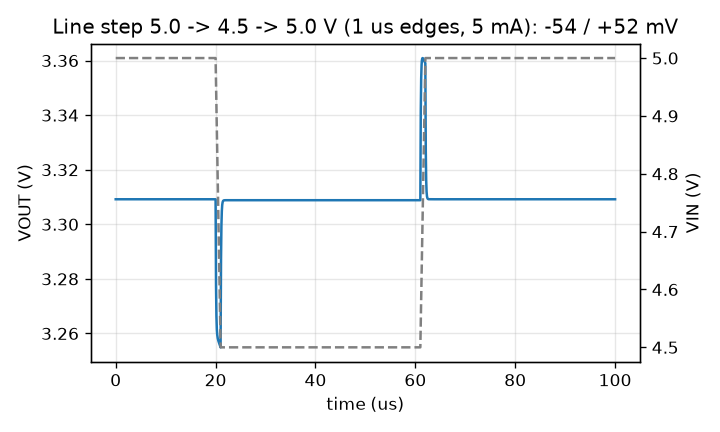

### Enable: turn-on and turn-off

VOUT (and EN) when EN pulses 0 → 3.3 V → 0 with a 660 Ω load. Result: VOUT reaches 3.2 V
1.65 µs after EN rises, and returns to 0 V when EN falls.

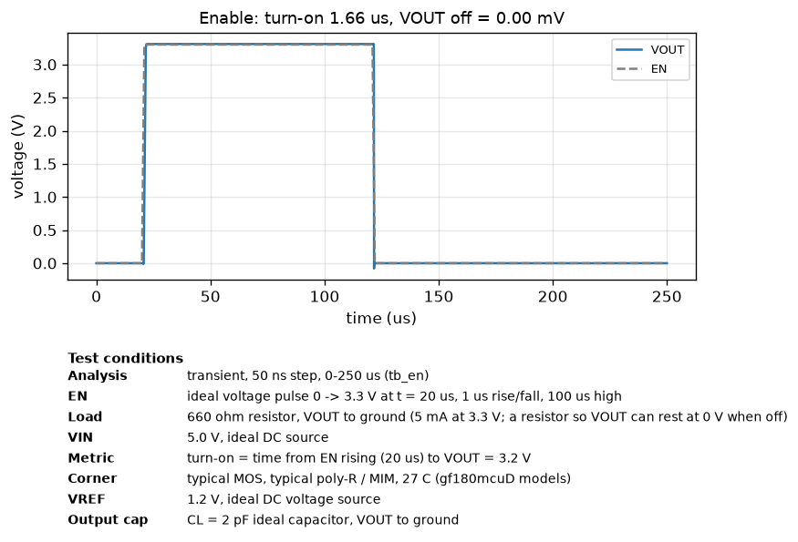

### Enable threshold

VOUT while EN is swept slowly from 0 to 3.3 V, at VIN = 4.5 V and 5.5 V. Result: switches at
1.39 / 1.58 V, safely inside the 0–3.3 V logic range.

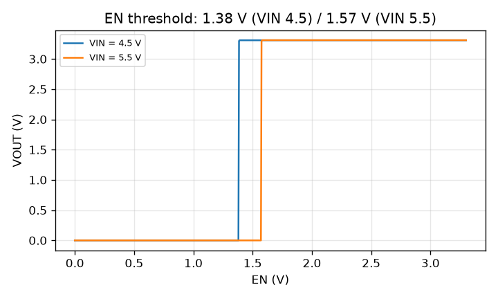

### Quiescent and shutdown current

Current drawn from VIN with no load, with the regulator on (EN = 3.3 V) and off (EN = 0 V).
Result: 60.0 µA on (spec ≤ 100 µA), 0.19 nA in shutdown.

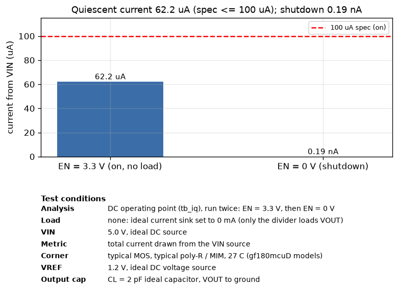

### Loop gain (stability)

Gain (top) and phase (bottom) of the regulation loop at every load, typical corner, 2 pF on
VOUT. Phase margin is how far the phase curve is from −180° where the gain curve crosses
0 dB, here around 1.5 MHz. Result: 70.6° in the worst case (target ≥ 45°). Details in the
next section.

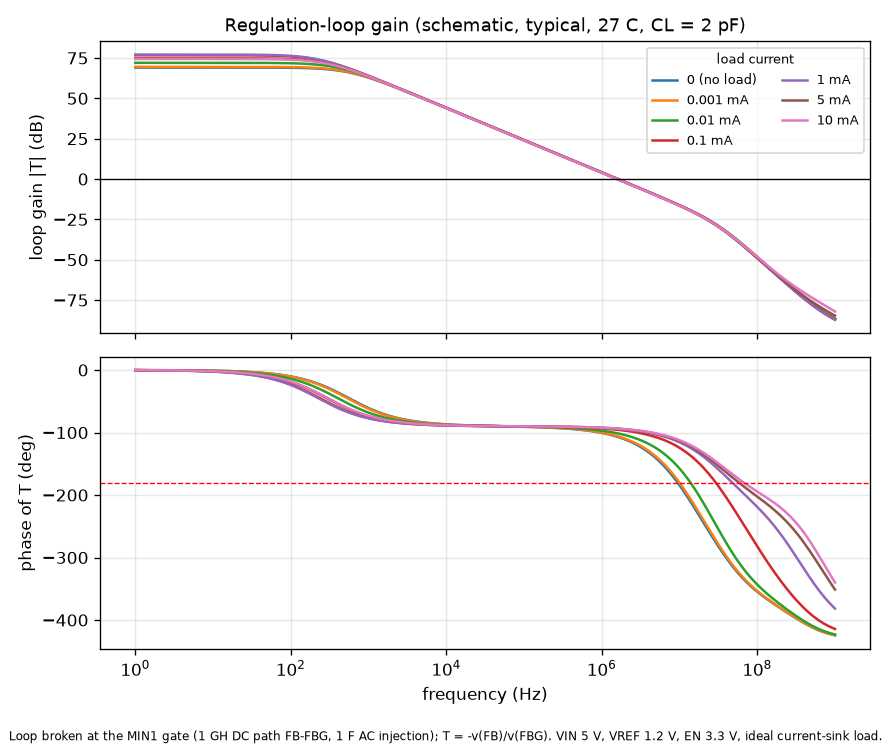

## Stability (loop gain)

`stability.py` opens the regulation loop for AC at the gate of the input transistor MIN1.
The gate gets its own node FBG, joined to the divider output FB through a 1 GH inductor:
a short at DC, so the operating point is unchanged, and open for AC. A 1 V AC source is
injected into FBG through a 1 F capacitor. The loop gain is T = −v(FB) / v(FBG). The gate
draws no current, so opening the loop there does not load the divider.

It sweeps load (0, 1 µA, 10 µA, 100 µA, 1 mA, 5 mA, 10 mA) × 5 MOS corners × −40 / 27 / 110 °C,
at output capacitances of 2 pF and 50 pF.

| Output capacitance | Worst phase margin | Where | UGF range | Min gain margin |
|---|---|---|---|---|
| 2 pF | **70.6°** | fs, 110 °C, no load | 1.31 – 1.94 MHz | 14.2 dB |
| 50 pF | 29.2° | fs, 110 °C, no load | 0.80 – 1.93 MHz | 13.4 dB |

The low-frequency loop gain is 49–75 dB.

Light load is the weak point, as in any capless LDO. The output pole sits at
≈ g_m(pass) / C_out, and the pass device's transconductance falls with its current.
Maximum output capacitance for ≥ 45° phase margin at the worst corner (fs, 110 °C):

| Load current | Max C_out |
|---|---|
| 0 (no load) | ≈ 15 pF |
| ≥ 10 µA | ≈ 30 pF |
| ≥ 100 µA | ≈ 150 pF |

**Usage note:** keep the capacitance on VOUT within these limits, or guarantee a minimum load.

### Miller-capacitor trade-off (Cc = 3 pF kept)

A larger Cc lowers the loop bandwidth and raises phase margin, at the cost of speed:

| Cc | PM, 0 mA / 50 pF (fs, 110 °C) | PM, 10 µA / 50 pF | Load step dip / overshoot | PSRR at 10 kHz | UGF |
|---|---|---|---|---|---|
| **3 pF (design)** | 29° | 38° | −212 / +313 mV | 44.0 dB | 1.58 MHz |
| 4 pF | 34° | 44° | −222 / +348 mV | 41.6 dB | 1.21 MHz |
| 5 pF | 38° | 49° | −235 / +382 mV | 39.8 dB | 0.97 MHz |
| 6 pF | 41° | 53° | −248 / +413 mV | 38.2 dB | 0.82 MHz |

Doubling Cc still misses 45° at no load with 50 pF, and it costs 32 % more overshoot and
6 dB of mid-band PSRR. So Cc stays at 3 pF and the output-capacitance limit is stated
instead. Adaptive biasing of the error amplifier would be the proper fix if heavier
capacitive loads must be supported.

## Other design checks

- **On-chip decoupling.** Ideal decaps of 5–20 pF were tried on VIN (with a 2 Ω + 5 nH supply
  model) and on VOUT. VIN decap: no change below 10 MHz. VOUT decap: the 1 µs load-step dip
  got worse (212 → 233 mV at 20 pF) because the output pole moves down. A fast (10 ns) 10 mA
  step dips ≈ 1 V whatever the decap. Holding it within 0.1 V would need ≈ 20 nF, which is not
  feasible on-chip. **No decap is used.** Loads with fast current edges need their own
  capacitance.
- **Shared buffer bias.** The two test buffers (FB_BUF, EAOUT_BUF) share one 2 MΩ bias leg
  (RrefEA → MREFEA, mirrored to MBIASEA and MBIASFB). Compared with the earlier two-leg
  version: identical specs at all 45 corners, buffer levels unchanged, Iq 62.2 → 60.0 µA
  (typical) and 90 → 87 µA (worst).
- **Shutdown.** With EN low, MBIASSW disconnects the bias resistors from VIN, pulldowns clamp
  the bias nodes, and MENPASSOFF holds the pass gate at VIN: 0.19 nA from VIN (typical).

## Reproducing

Requires xschem, ngspice, the gf180mcuD PDK with `PDK_ROOT` set, and Python 3 with numpy and
matplotlib (all in IIC-OSIC-TOOLS).

```sh
cd simulations
python3 run_sims.py --corners    # all spec tests, typical + 45 corners -> results/
python3 stability.py             # loop gain / phase margin sweep      -> results/stability.*
```
