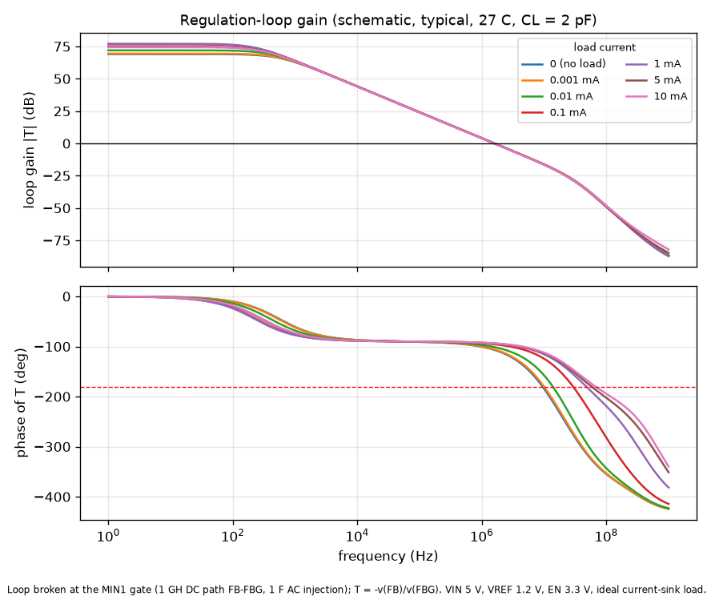

# Regulation-loop stability (schematic)

Generated by `simulations/stability.py`. Loop broken at the MIN1 gate; T = -v(FB)/v(FBG).
Swept: load 0-10 mA, MOS corners tt/ff/ss/fs/sf, -40/27/110 C, output capacitance 2 pF and 50 pF.

| CL | worst-case PM | at | lowest UGF | highest UGF | min GM |
|---|---|---|---|---|---|
| 2 pF | 70.6 deg | fs, 110 C, 0 mA | 1.31 MHz | 1.94 MHz | 14.2 dB |
| 50 pF | 29.2 deg | fs, 110 C, 0 mA | 0.80 MHz | 1.93 MHz | 13.5 dB |

Typical corner, 27 C:

| Load | CL | T(dc) | UGF | PM | GM |
|---|---|---|---|---|---|
| 0 mA | 2 pF | 69.1 dB | 1.58 MHz | 73.3 deg | 15.7 dB |
| 0.001 mA | 2 pF | 69.5 dB | 1.59 MHz | 74.2 deg | 15.7 dB |
| 0.01 mA | 2 pF | 72.0 dB | 1.60 MHz | 78.7 deg | 19.2 dB |
| 0.1 mA | 2 pF | 76.7 dB | 1.61 MHz | 84.4 deg | 27.9 dB |
| 1 mA | 2 pF | 77.1 dB | 1.61 MHz | 85.8 deg | 35.7 dB |
| 5 mA | 2 pF | 74.8 dB | 1.59 MHz | 86.2 deg | 38.5 dB |
| 10 mA | 2 pF | 74.4 dB | 1.57 MHz | 86.4 deg | 41.2 dB |
| 0 mA | 50 pF | 69.1 dB | 0.96 MHz | 32.0 deg | 14.9 dB |
| 0.001 mA | 50 pF | 69.5 dB | 0.99 MHz | 33.3 deg | 15.3 dB |
| 0.01 mA | 50 pF | 72.0 dB | 1.17 MHz | 42.4 deg | 17.2 dB |
| 0.1 mA | 50 pF | 76.7 dB | 1.54 MHz | 68.9 deg | 22.2 dB |
| 1 mA | 50 pF | 77.1 dB | 1.60 MHz | 81.6 deg | 26.4 dB |
| 5 mA | 50 pF | 74.8 dB | 1.59 MHz | 84.0 deg | 28.7 dB |
| 10 mA | 50 pF | 74.4 dB | 1.57 MHz | 84.9 deg | 30.7 dB |

