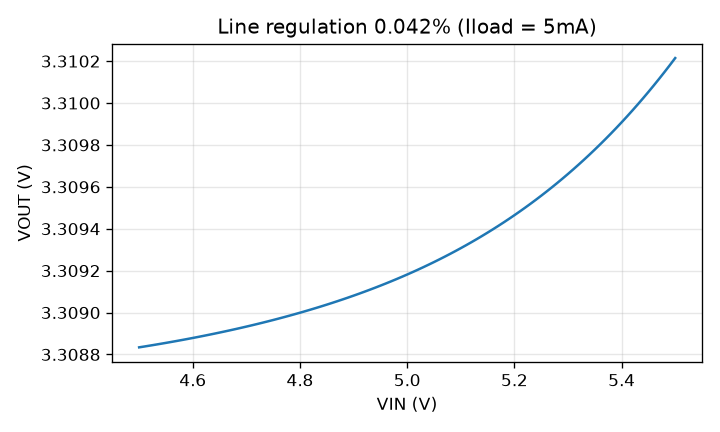
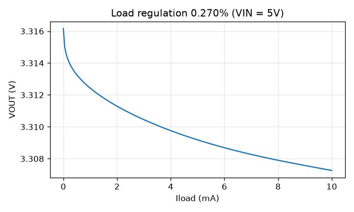
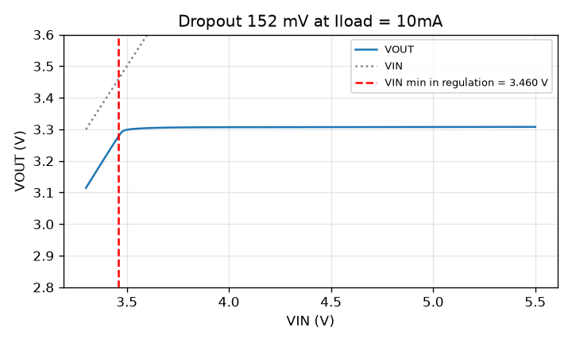
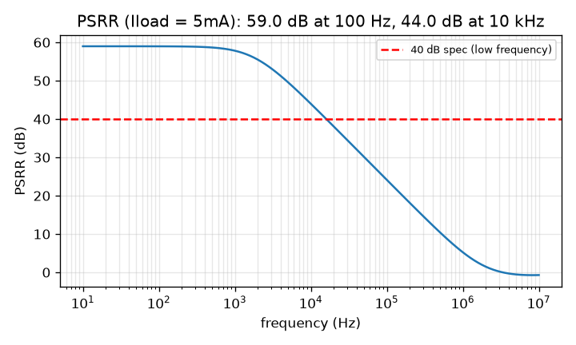
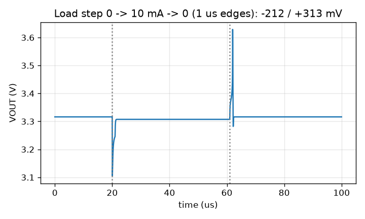
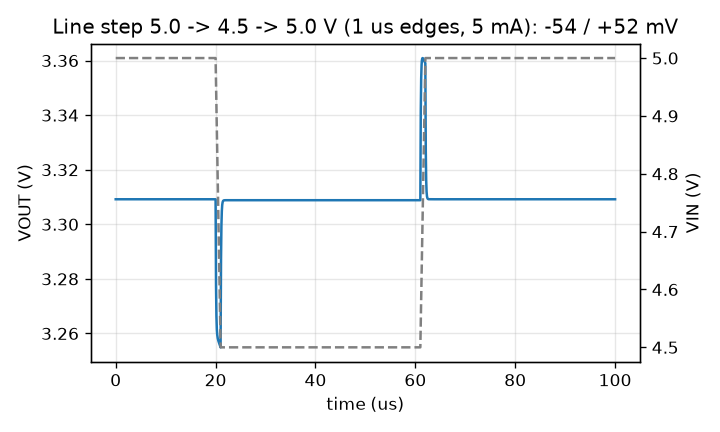
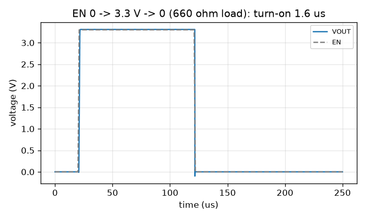
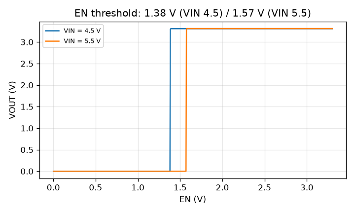

# Simulation results (schematic, pre-layout)

Generated by `simulations/run_sims.py`. Typical corner, 27 C, VIN = 5.0 V, VREF = 1.2 V,
EN = 3.3 V (harness logic level), CL = 2 pF, unless noted.

| Parameter | Spec | Simulated | Result | Testbench |
|---|---|---|---|---|
| Output voltage (5 mA) | 3.201 - 3.399 V | 3.3092 V | PASS | tb_load_reg |
| Dropout (10 mA) | <= 300 mV | 152 mV | PASS | tb_dropout |
| Quiescent current (no load) | <= 100 uA | 62.4 uA | PASS | tb_iq |
| Line regulation (4.5-5.5 V, 5 mA) | <= 1.0 % | 0.042 % | PASS | tb_line_reg |
| Load regulation (0-10 mA) | <= 1.0 % | 0.270 % | PASS | tb_load_reg |
| PSRR (100 Hz, 5 mA) | >= 40 dB | 59.0 dB | PASS | tb_psrr |
| PSRR (10 kHz / 1 MHz) | - | 44.0 / 5.2 dB | info | tb_psrr |
| Load step 0->10 mA, 1 us | - | -212 / +313 mV | info | tb_tran_load |
| Line step 5.0->4.5 V, 1 us | - | -54 / +52 mV | info | tb_tran_line |
| EN off -> VOUT | 0 V | 0.00 mV | PASS | tb_en |
| EN turn-on time (to 3.2 V) | - | 1.62 us | info | tb_en |
| EN switching threshold | 3.3 V logic | 1.38 / 1.57 V (VIN 4.5 / 5.5) | PASS | tb_en_dc |
| Shutdown current (EN = 0) | - | 46.5 uA | info | tb_iq |

 
 
 
 

## Process corners x temperature (VIN = 5.0 V)

MOS corners tt/ff/ss/fs/sf x poly-resistor and MIM-capacitor corners typical/ff/ss x -40/27/110 C.

| MOS corner | R/C corner | Temp (C) | VOUT @5 mA (V) | Iq (uA) | Line reg (%) | Load reg (%) | Dropout @10 mA (mV) | PSRR @100 Hz (dB) |
|---|---|---|---|---|---|---|---|---|
| typical | typical | -40 | 3.3086  | 57.4  | 0.033  | 0.207  | 107  | 61.1  |
| typical | typical | 27 | 3.3092  | 62.4  | 0.042  | 0.270  | 152  | 59.0  |
| typical | typical | 110 | 3.3097  | 67.6  | 0.050  | 0.379  | 207  | 57.2  |
| typical | ff | -40 | 3.3089  | 70.4  | 0.039  | 0.215  | 107  | 59.6  |
| typical | ff | 27 | 3.3099  | 76.6  | 0.048  | 0.286  | 152  | 57.6  |
| typical | ff | 110 | 3.3108  | 83.0  | 0.058  | 0.422  | 206  | 56.0  |
| typical | ss | -40 | 3.3084  | 48.6  | 0.029  | 0.202  | 108  | 62.5  |
| typical | ss | 27 | 3.3087  | 52.8  | 0.037  | 0.260  | 153  | 60.2  |
| typical | ss | 110 | 3.3090  | 57.2  | 0.045  | 0.355  | 208  | 58.4  |
| ff | typical | -40 | 3.3080  | 62.8  | 0.045  | 0.203  | 83  | 58.2  |
| ff | typical | 27 | 3.3088  | 68.2  | 0.057  | 0.276  | 122  | 56.2  |
| ff | typical | 110 | 3.3095  | 73.9  | 0.068  | 0.559  | 167  | 54.5  |
| ff | ff | -40 | 3.3084  | 76.9  | 0.052  | 0.213  | 82  | 56.9  |
| ff | ff | 27 | 3.3095  | 83.5  | 0.065  | 0.297  | 122  | 55.0  |
| ff | ff | 110 | 3.3106  | 90.4  | 0.078  | 0.745  | 166  | 53.2  |
| ff | ss | -40 | 3.3078  | 53.4  | 0.040  | 0.197  | 83  | 59.3  |
| ff | ss | 27 | 3.3083  | 57.9  | 0.051  | 0.263  | 123  | 57.2  |
| ff | ss | 110 | 3.3087  | 62.7  | 0.061  | 0.467  | 168  | 55.5  |
| ss | typical | -40 | 3.3093  | 53.4  | 0.021  | 0.218  | 137  | 66.0  |
| ss | typical | 27 | 3.3098  | 58.1  | 0.026  | 0.278  | 192  | 63.6  |
| ss | typical | 110 | 3.3102  | 62.9  | 0.030  | 0.364  | 262  | 61.9  |
| ss | ff | -40 | 3.3095  | 65.4  | 0.023  | 0.225  | 137  | 64.8  |
| ss | ff | 27 | 3.3104  | 71.1  | 0.028  | 0.290  | 191  | 62.9  |
| ss | ff | 110 | 3.3111  | 77.0  | 0.031  | 0.386  | 261  | 61.6  |
| ss | ss | -40 | 3.3092  | 45.3  | 0.018  | 0.215  | 137  | 67.2  |
| ss | ss | 27 | 3.3094  | 49.2  | 0.023  | 0.270  | 192  | 64.7  |
| ss | ss | 110 | 3.3095  | 53.2  | 0.027  | 0.349  | 262  | 62.8  |
| fs | typical | -40 | 3.3094  | 60.1  | 0.018  | 0.209  | 132  | 66.8  |
| fs | typical | 27 | 3.3101  | 65.5  | 0.023  | 0.269  | 187  | 64.1  |
| fs | typical | 110 | 3.3108  | 71.1  | 0.028  | 0.363  | 251  | 62.1  |
| fs | ff | -40 | 3.3098  | 73.8  | 0.022  | 0.217  | 132  | 64.8  |
| fs | ff | 27 | 3.3109  | 80.4  | 0.027  | 0.284  | 186  | 62.5  |
| fs | ff | 110 | 3.3121  | 87.2  | 0.031  | 0.397  | 245  | 61.0  |
| fs | ss | -40 | 3.3092  | 50.9  | 0.015  | 0.204  | 132  | 68.8  |
| fs | ss | 27 | 3.3096  | 55.4  | 0.020  | 0.260  | 187  | 65.5  |
| fs | ss | 110 | 3.3100  | 60.2  | 0.025  | 0.343  | 252  | 63.3  |
| sf | typical | -40 | 3.3080  | 55.3  | 0.053  | 0.211  | 88  | 56.8  |
| sf | typical | 27 | 3.3085  | 59.9  | 0.065  | 0.281  | 123  | 55.1  |
| sf | typical | 110 | 3.3090  | 64.8  | 0.077  | 0.430  | 173  | 53.5  |
| sf | ff | -40 | 3.3082  | 67.7  | 0.060  | 0.220  | 88  | 55.8  |
| sf | ff | 27 | 3.3091  | 73.4  | 0.072  | 0.297  | 122  | 54.1  |
| sf | ff | 110 | 3.3099  | 79.3  | 0.085  | 0.498  | 172  | 52.6  |
| sf | ss | -40 | 3.3078  | 47.0  | 0.048  | 0.206  | 88  | 57.8  |
| sf | ss | 27 | 3.3081  | 50.8  | 0.058  | 0.270  | 123  | 56.0  |
| sf | ss | 110 | 3.3083  | 54.9  | 0.070  | 0.394  | 168  | 54.4  |
