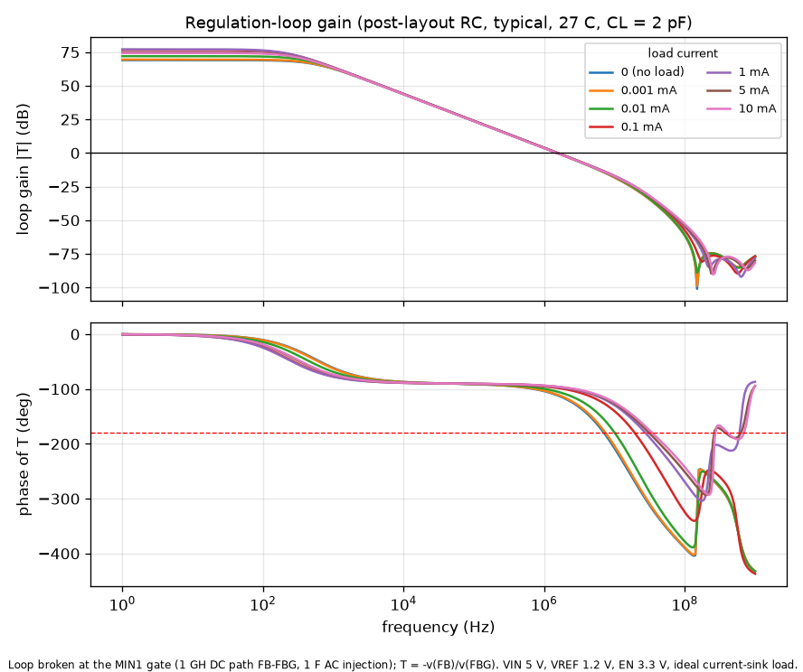

# Regulation-loop stability (post-layout, extracted RC netlist)

Generated by `simulations/stability.py`. Loop broken at the MIN1 gate; T = -v(FB)/v(FBG).
Swept: load 0-10 mA, MOS corners tt/ff/ss/fs/sf, -40/27/110 C, output capacitance 2 pF and 50 pF.

| CL | worst-case PM | at | lowest UGF | highest UGF | min GM |
|---|---|---|---|---|---|
| 2 pF | 65.7 deg | fs, 110 C, 0 mA | 1.27 MHz | 1.88 MHz | 12.8 dB |
| 50 pF | 26.9 deg | fs, 110 C, 0 mA | 0.75 MHz | 1.88 MHz | 11.9 dB |

Typical corner, 27 C:

| Load | CL | T(dc) | UGF | PM | GM |
|---|---|---|---|---|---|
| 0 mA | 2 pF | 69.1 dB | 1.53 MHz | 68.7 deg | 14.4 dB |
| 0.001 mA | 2 pF | 69.5 dB | 1.53 MHz | 69.8 deg | 14.3 dB |
| 0.01 mA | 2 pF | 72.0 dB | 1.55 MHz | 75.2 deg | 17.6 dB |
| 0.1 mA | 2 pF | 76.7 dB | 1.57 MHz | 81.9 deg | 24.6 dB |
| 1 mA | 2 pF | 77.1 dB | 1.57 MHz | 83.6 deg | 29.4 dB |
| 5 mA | 2 pF | 74.8 dB | 1.55 MHz | 84.1 deg | 31.2 dB |
| 10 mA | 2 pF | 74.3 dB | 1.53 MHz | 84.5 deg | 32.8 dB |
| 0 mA | 50 pF | 69.1 dB | 0.91 MHz | 29.6 deg | 13.1 dB |
| 0.001 mA | 50 pF | 69.5 dB | 0.93 MHz | 30.8 deg | 13.4 dB |
| 0.01 mA | 50 pF | 72.0 dB | 1.11 MHz | 39.5 deg | 15.4 dB |
| 0.1 mA | 50 pF | 76.7 dB | 1.49 MHz | 65.7 deg | 19.6 dB |
| 1 mA | 50 pF | 77.1 dB | 1.56 MHz | 79.1 deg | 22.7 dB |
| 5 mA | 50 pF | 74.8 dB | 1.55 MHz | 81.8 deg | 25.4 dB |
| 10 mA | 50 pF | 74.3 dB | 1.53 MHz | 82.8 deg | 26.6 dB |

