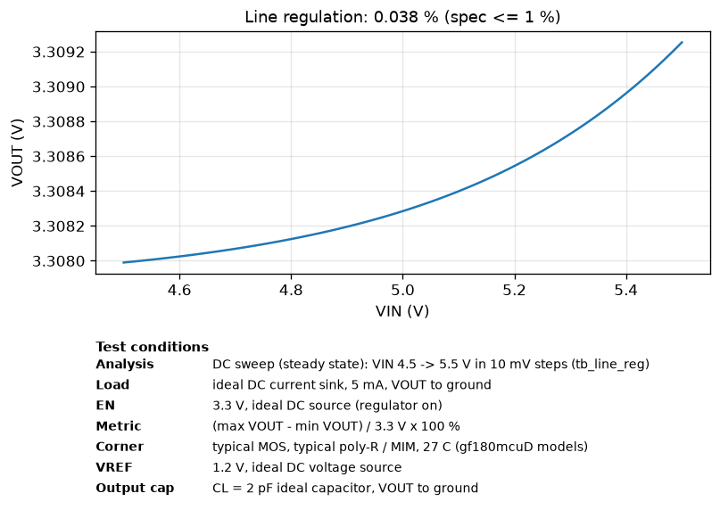
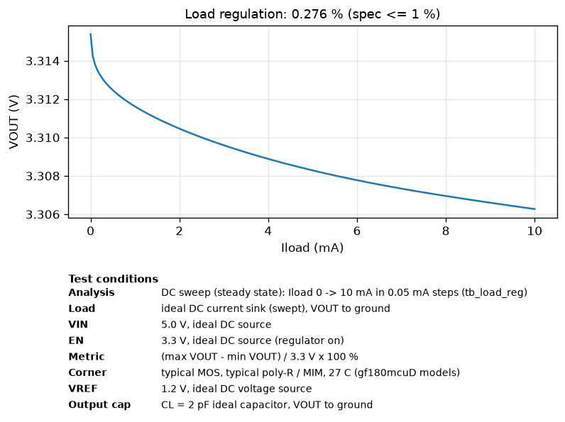
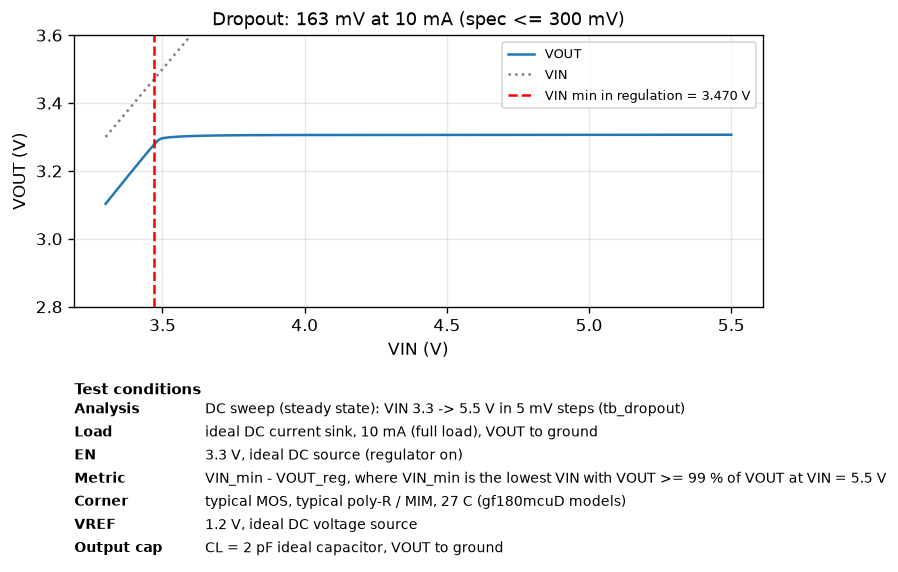
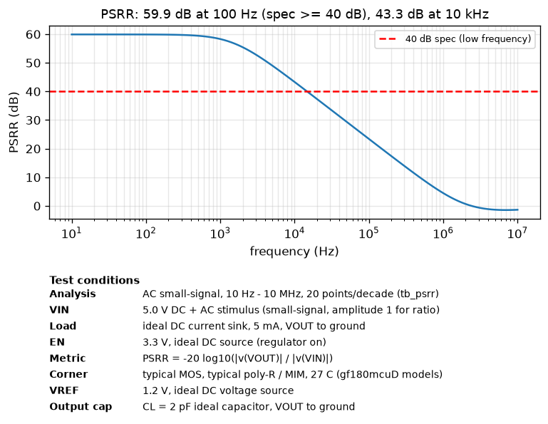
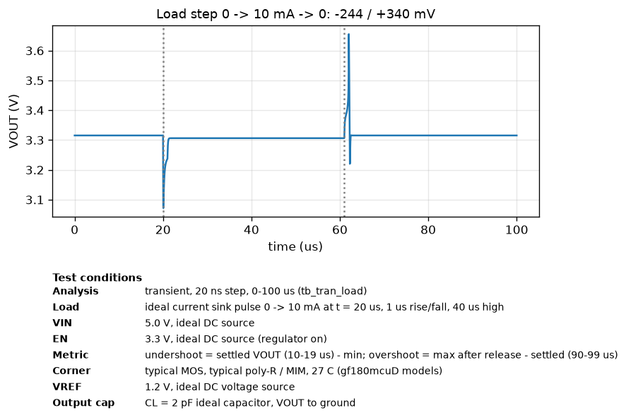
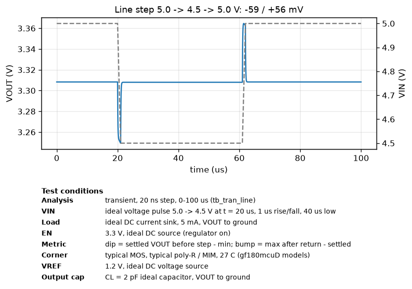
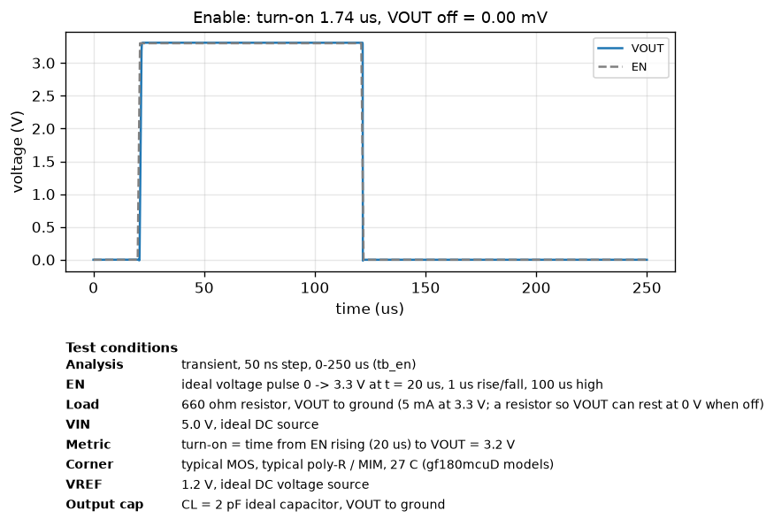
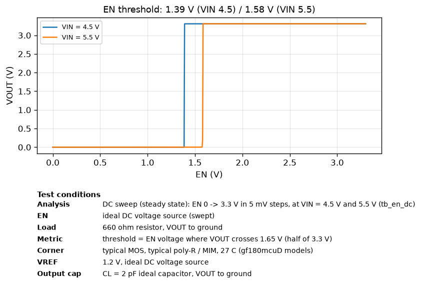
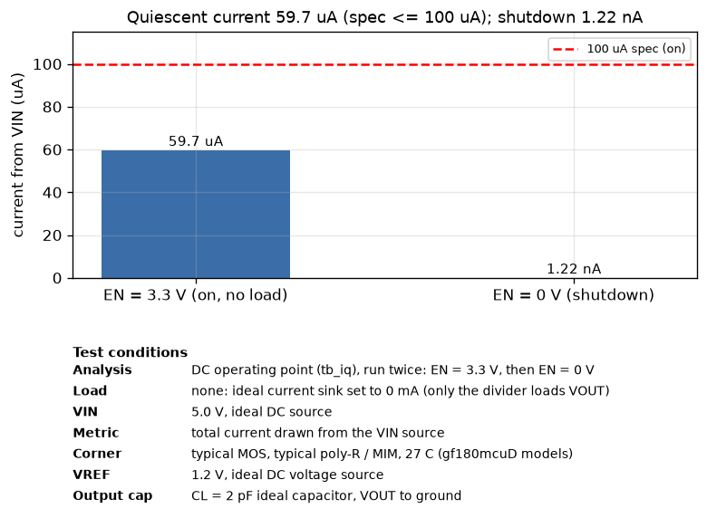

# Simulation results (post-layout, extracted RC netlist)

Generated by `simulations/run_sims.py`. Typical corner, 27 C, VIN = 5.0 V, VREF = 1.2 V,
EN = 3.3 V (harness logic level), CL = 2 pF, unless noted.

| Parameter | Spec | Simulated | Result | Testbench |
|---|---|---|---|---|
| Output voltage (5 mA) | 3.201 - 3.399 V | 3.3083 V | PASS | tb_load_reg |
| Dropout (10 mA) | <= 300 mV | 163 mV | PASS | tb_dropout |
| Quiescent current (no load) | <= 100 uA | 59.7 uA | PASS | tb_iq |
| Line regulation (4.5-5.5 V, 5 mA) | <= 1.0 % | 0.038 % | PASS | tb_line_reg |
| Load regulation (0-10 mA) | <= 1.0 % | 0.276 % | PASS | tb_load_reg |
| PSRR (100 Hz, 5 mA) | >= 40 dB | 59.9 dB | PASS | tb_psrr |
| PSRR (10 kHz / 1 MHz) | - | 43.3 / 4.5 dB | info | tb_psrr |
| Load step 0->10 mA, 1 us | - | -244 / +340 mV | info | tb_tran_load |
| Line step 5.0->4.5 V, 1 us | - | -59 / +56 mV | info | tb_tran_line |
| EN off -> VOUT | 0 V | 0.00 mV | PASS | tb_en |
| EN turn-on time (to 3.2 V) | - | 1.74 us | info | tb_en |
| EN switching threshold | 3.3 V logic | 1.39 / 1.58 V (VIN 4.5 / 5.5) | PASS | tb_en_dc |
| Shutdown current (EN = 0) | - | 1.22 nA | info | tb_iq |
| Test buffer FB_BUF (FB - FB_BUF) | follows FB | 0.442 V (0.763 V below FB = 1.206 V) | info | tb_iq |
| Test buffer EAOUT_BUF (EAOUT - EAOUT_BUF) | follows EAOUT | 2.908 V (1.331 V below EAOUT = 4.239 V) | info | tb_iq |

 
 
 
 

