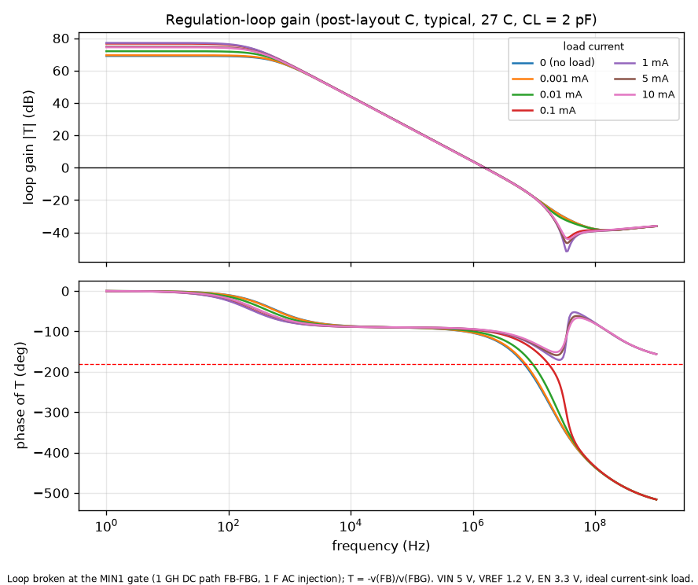

# Regulation-loop stability (post-layout, extracted C-only netlist)

Generated by `simulations/stability.py`. Loop broken at the MIN1 gate; T = -v(FB)/v(FBG).
Swept: load 0-10 mA, MOS corners tt/ff/ss/fs/sf, -40/27/110 C, output capacitance 2 pF and 50 pF.

| CL | worst-case PM | at | lowest UGF | highest UGF | min GM |
|---|---|---|---|---|---|
| 2 pF | 65.6 deg | fs, 110 C, 0 mA | 1.27 MHz | 1.89 MHz | 12.8 dB |
| 50 pF | 26.6 deg | fs, 110 C, 0 mA | 0.76 MHz | 1.88 MHz | 10.6 dB |

Typical corner, 27 C:

| Load | CL | T(dc) | UGF | PM | GM |
|---|---|---|---|---|---|
| 0 mA | 2 pF | 69.0 dB | 1.54 MHz | 68.6 deg | 13.8 dB |
| 0.001 mA | 2 pF | 69.5 dB | 1.54 MHz | 69.6 deg | 14.4 dB |
| 0.01 mA | 2 pF | 72.0 dB | 1.55 MHz | 74.6 deg | 17.0 dB |
| 0.1 mA | 2 pF | 76.7 dB | 1.57 MHz | 80.8 deg | 26.5 dB |
| 1 mA | 2 pF | 77.1 dB | 1.57 MHz | 82.4 deg | inf dB |
| 5 mA | 2 pF | 74.8 dB | 1.55 MHz | 82.9 deg | inf dB |
| 10 mA | 2 pF | 74.4 dB | 1.53 MHz | 83.5 deg | inf dB |
| 0 mA | 50 pF | 69.0 dB | 0.92 MHz | 29.2 deg | 11.8 dB |
| 0.001 mA | 50 pF | 69.5 dB | 0.95 MHz | 30.5 deg | 12.2 dB |
| 0.01 mA | 50 pF | 72.0 dB | 1.13 MHz | 39.1 deg | 14.2 dB |
| 0.1 mA | 50 pF | 76.7 dB | 1.50 MHz | 65.1 deg | 17.2 dB |
| 1 mA | 50 pF | 77.1 dB | 1.56 MHz | 78.1 deg | 22.1 dB |
| 5 mA | 50 pF | 74.8 dB | 1.55 MHz | 80.7 deg | 26.3 dB |
| 10 mA | 50 pF | 74.4 dB | 1.53 MHz | 81.9 deg | 29.5 dB |

