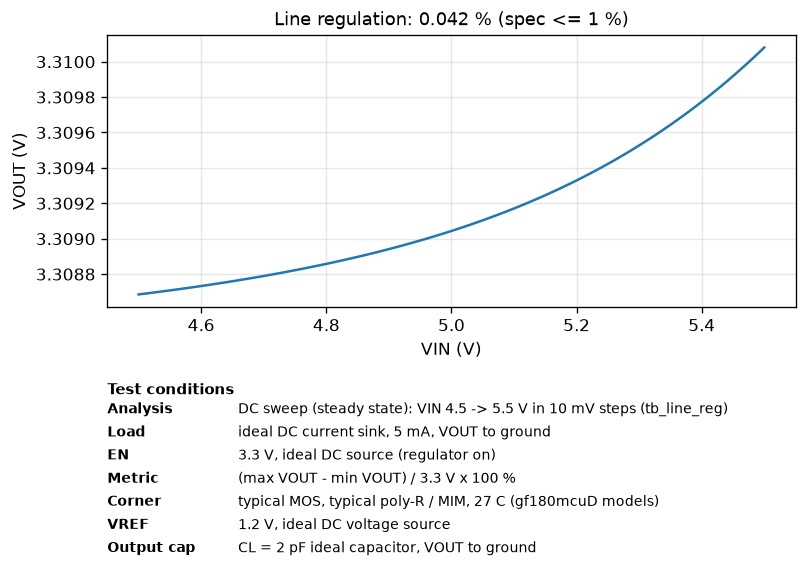
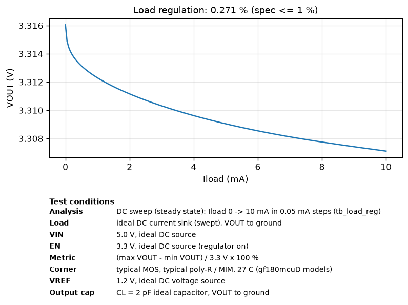
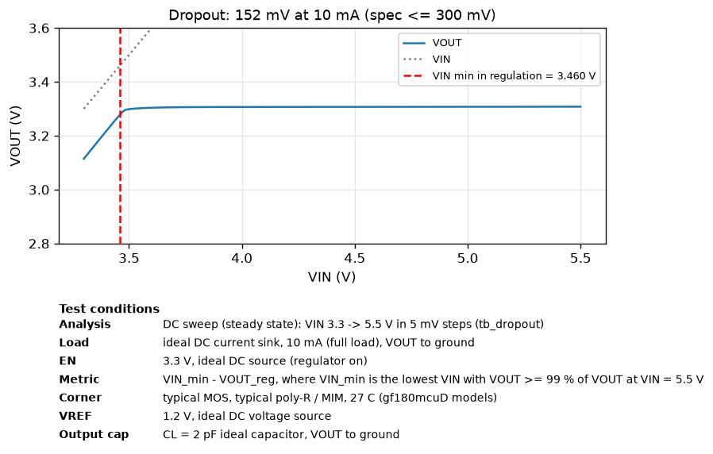
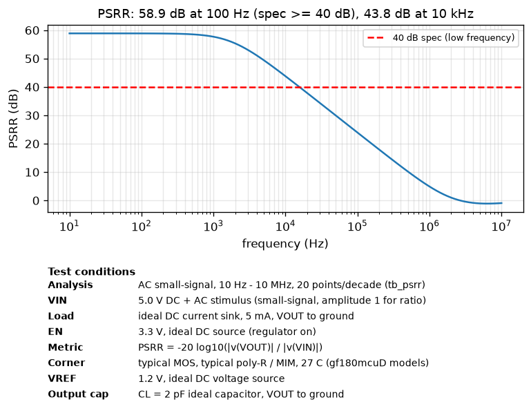
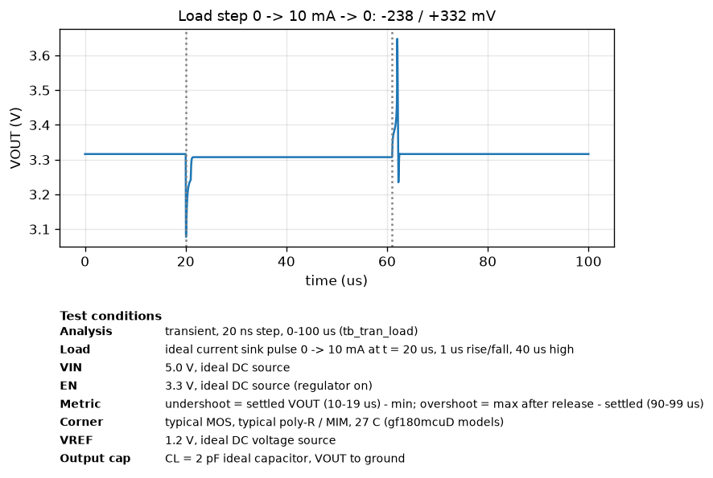
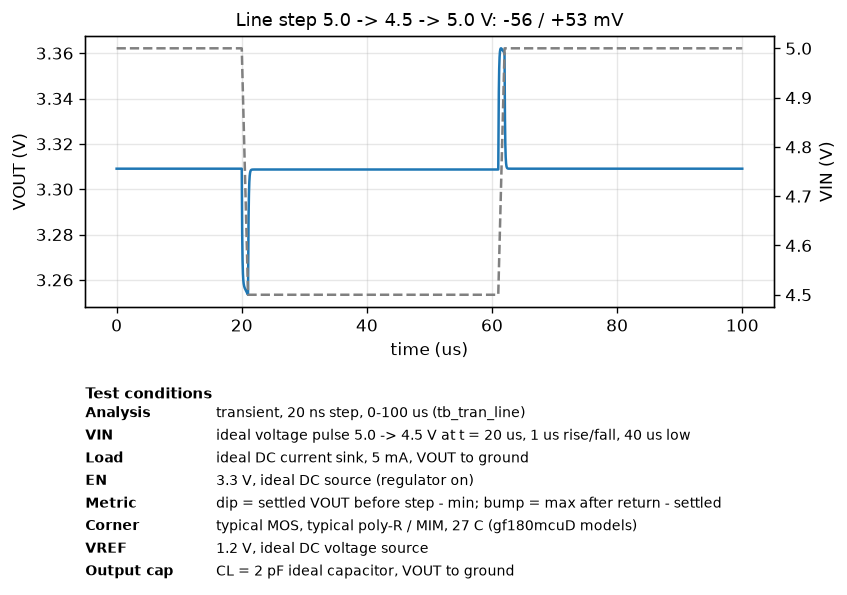
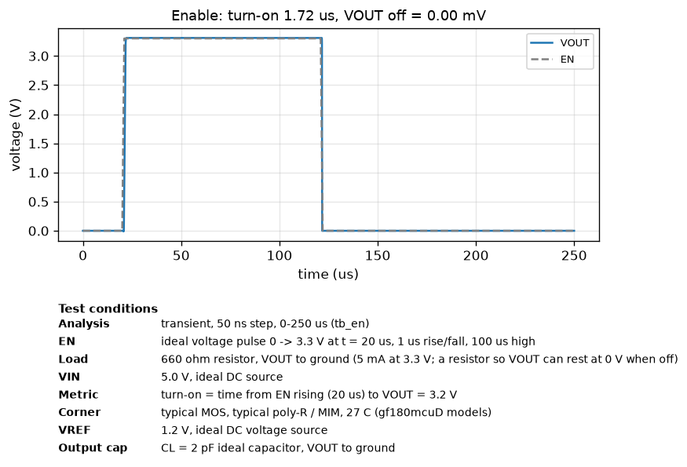
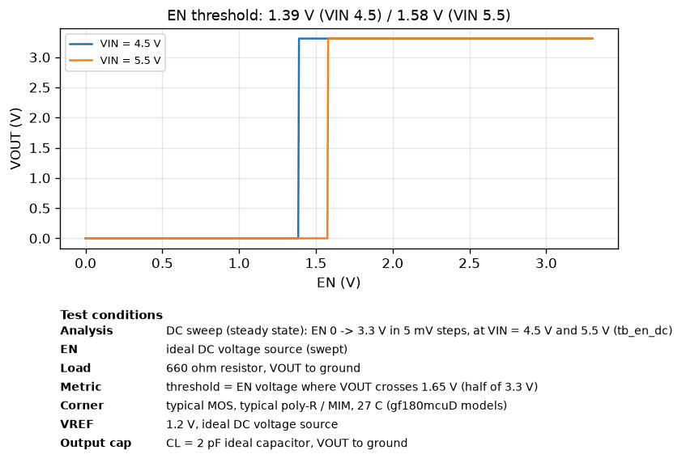
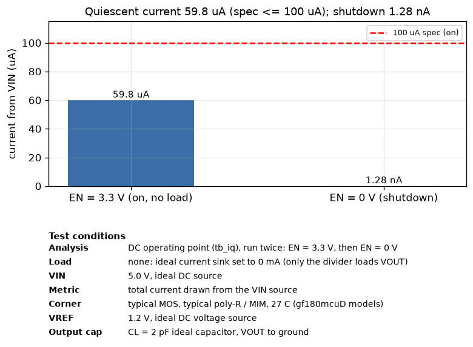

# Simulation results (post-layout, extracted C-only netlist)

Generated by `simulations/run_sims.py`. Typical corner, 27 C, VIN = 5.0 V, VREF = 1.2 V,
EN = 3.3 V (harness logic level), CL = 2 pF, unless noted.

| Parameter | Spec | Simulated | Result | Testbench |
|---|---|---|---|---|
| Output voltage (5 mA) | 3.201 - 3.399 V | 3.3090 V | PASS | tb_load_reg |
| Dropout (10 mA) | <= 300 mV | 152 mV | PASS | tb_dropout |
| Quiescent current (no load) | <= 100 uA | 59.8 uA | PASS | tb_iq |
| Line regulation (4.5-5.5 V, 5 mA) | <= 1.0 % | 0.042 % | PASS | tb_line_reg |
| Load regulation (0-10 mA) | <= 1.0 % | 0.271 % | PASS | tb_load_reg |
| PSRR (100 Hz, 5 mA) | >= 40 dB | 58.9 dB | PASS | tb_psrr |
| PSRR (10 kHz / 1 MHz) | - | 43.8 / 4.9 dB | info | tb_psrr |
| Load step 0->10 mA, 1 us | - | -238 / +332 mV | info | tb_tran_load |
| Line step 5.0->4.5 V, 1 us | - | -56 / +53 mV | info | tb_tran_line |
| EN off -> VOUT | 0 V | 0.00 mV | PASS | tb_en |
| EN turn-on time (to 3.2 V) | - | 1.72 us | info | tb_en |
| EN switching threshold | 3.3 V logic | 1.39 / 1.58 V (VIN 4.5 / 5.5) | PASS | tb_en_dc |
| Shutdown current (EN = 0) | - | 1.28 nA | info | tb_iq |
| Test buffer FB_BUF (FB - FB_BUF) | follows FB | 0.442 V (0.764 V below FB = 1.206 V) | info | tb_iq |
| Test buffer EAOUT_BUF (EAOUT - EAOUT_BUF) | follows EAOUT | 2.908 V (1.331 V below EAOUT = 4.239 V) | info | tb_iq |

 
 
 
 

## Process corners x temperature (VIN = 5.0 V)

MOS corners tt/ff/ss/fs/sf x poly-resistor and MIM-capacitor corners typical/ff/ss x -40/27/110 C.
Each column uses the same testbench and load as the typical table above: VOUT at a 5 mA ideal current
sink (tb_load_reg), Iq and off current with no load (tb_iq), line reg at 5 mA, load reg 0-10 mA,
dropout at 10 mA, PSRR at 5 mA.

| MOS corner | R/C corner | Temp (C) | VOUT @5 mA (V) | Iq (uA) | Line reg (%) | Load reg (%) | Dropout @10 mA (mV) | PSRR @100 Hz (dB) | Off current, EN = 0 (nA) |
|---|---|---|---|---|---|---|---|---|---|
| typical | typical | -40 | 3.3089  | 55.1  | 0.034  | 0.207  | 107  | 61.0  | 1.27 |
| typical | typical | 27 | 3.3090  | 59.8  | 0.042  | 0.271  | 152  | 58.9  | 1.28 |
| typical | typical | 110 | 3.3094  | 64.8  | 0.051  | 0.382  | 207  | 57.1  | 1.50 |
| typical | ff | -40 | 3.3095  | 67.5  | 0.040  | 0.216  | 107  | 59.5  | 1.27 |
| typical | ff | 27 | 3.3099  | 73.4  | 0.049  | 0.287  | 152  | 57.5  | 1.28 |
| typical | ff | 110 | 3.3106  | 79.4  | 0.058  | 0.426  | 206  | 55.9  | 1.50 |
| typical | ss | -40 | 3.3085  | 46.7  | 0.029  | 0.203  | 108  | 62.3  | 1.27 |
| typical | ss | 27 | 3.3085  | 50.7  | 0.037  | 0.261  | 153  | 60.1  | 1.28 |
| typical | ss | 110 | 3.3086  | 54.9  | 0.045  | 0.357  | 203  | 58.2  | 1.50 |
| ff | typical | -40 | 3.3083  | 60.5  | 0.045  | 0.203  | 83  | 58.2  | 1.29 |
| ff | typical | 27 | 3.3086  | 65.6  | 0.056  | 0.276  | 123  | 56.2  | 1.31 |
| ff | typical | 110 | 3.3091  | 71.1  | 0.068  | 0.563  | 168  | 54.5  | 4.54 |
| ff | ff | -40 | 3.3090  | 73.9  | 0.052  | 0.213  | 82  | 56.9  | 1.29 |
| ff | ff | 27 | 3.3095  | 80.2  | 0.065  | 0.297  | 122  | 55.0  | 1.31 |
| ff | ff | 110 | 3.3104  | 86.9  | 0.078  | 0.748  | 166  | 53.2  | 4.54 |
| ff | ss | -40 | 3.3079  | 51.5  | 0.040  | 0.197  | 83  | 59.3  | 1.29 |
| ff | ss | 27 | 3.3079  | 55.8  | 0.051  | 0.263  | 123  | 57.2  | 1.31 |
| ff | ss | 110 | 3.3082  | 60.4  | 0.061  | 0.470  | 168  | 55.5  | 4.54 |
| ss | typical | -40 | 3.3096  | 51.2  | 0.021  | 0.219  | 137  | 65.6  | 1.26 |
| ss | typical | 27 | 3.3097  | 55.5  | 0.026  | 0.279  | 192  | 63.2  | 1.26 |
| ss | typical | 110 | 3.3099  | 60.1  | 0.031  | 0.367  | 262  | 61.5  | 1.29 |
| ss | ff | -40 | 3.3102  | 62.5  | 0.024  | 0.226  | 136  | 64.4  | 1.26 |
| ss | ff | 27 | 3.3105  | 67.9  | 0.029  | 0.291  | 191  | 62.5  | 1.26 |
| ss | ff | 110 | 3.3110  | 73.4  | 0.032  | 0.390  | 261  | 61.2  | 1.29 |
| ss | ss | -40 | 3.3093  | 43.4  | 0.019  | 0.215  | 137  | 66.8  | 1.26 |
| ss | ss | 27 | 3.3091  | 47.1  | 0.024  | 0.272  | 192  | 64.3  | 1.26 |
| ss | ss | 110 | 3.3092  | 51.0  | 0.028  | 0.352  | 263  | 62.4  | 1.29 |
| fs | typical | -40 | 3.3098  | 57.8  | 0.019  | 0.210  | 132  | 66.4  | 1.26 |
| fs | typical | 27 | 3.3100  | 62.9  | 0.024  | 0.270  | 187  | 63.7  | 1.27 |
| fs | typical | 110 | 3.3105  | 68.2  | 0.029  | 0.366  | 252  | 61.8  | 2.11 |
| fs | ff | -40 | 3.3105  | 70.8  | 0.023  | 0.218  | 131  | 64.5  | 1.26 |
| fs | ff | 27 | 3.3110  | 77.1  | 0.028  | 0.286  | 186  | 62.2  | 1.27 |
| fs | ff | 110 | 3.3119  | 83.5  | 0.032  | 0.401  | 246  | 60.7  | 2.11 |
| fs | ss | -40 | 3.3093  | 49.0  | 0.016  | 0.205  | 132  | 68.3  | 1.26 |
| fs | ss | 27 | 3.3094  | 53.3  | 0.021  | 0.261  | 187  | 65.2  | 1.27 |
| fs | ss | 110 | 3.3096  | 57.8  | 0.026  | 0.345  | 252  | 62.9  | 2.11 |
| sf | typical | -40 | 3.3083  | 53.1  | 0.053  | 0.212  | 87  | 56.8  | 1.28 |
| sf | typical | 27 | 3.3083  | 57.4  | 0.065  | 0.281  | 123  | 55.0  | 1.29 |
| sf | typical | 110 | 3.3086  | 62.0  | 0.077  | 0.433  | 168  | 53.5  | 1.92 |
| sf | ff | -40 | 3.3088  | 64.8  | 0.060  | 0.221  | 87  | 55.7  | 1.28 |
| sf | ff | 27 | 3.3091  | 70.2  | 0.072  | 0.298  | 122  | 54.0  | 1.29 |
| sf | ff | 110 | 3.3097  | 75.9  | 0.086  | 0.502  | 172  | 52.5  | 1.92 |
| sf | ss | -40 | 3.3079  | 45.1  | 0.048  | 0.206  | 88  | 57.8  | 1.28 |
| sf | ss | 27 | 3.3078  | 48.7  | 0.059  | 0.270  | 123  | 56.0  | 1.29 |
| sf | ss | 110 | 3.3078  | 52.6  | 0.070  | 0.396  | 169  | 54.4  | 1.92 |
