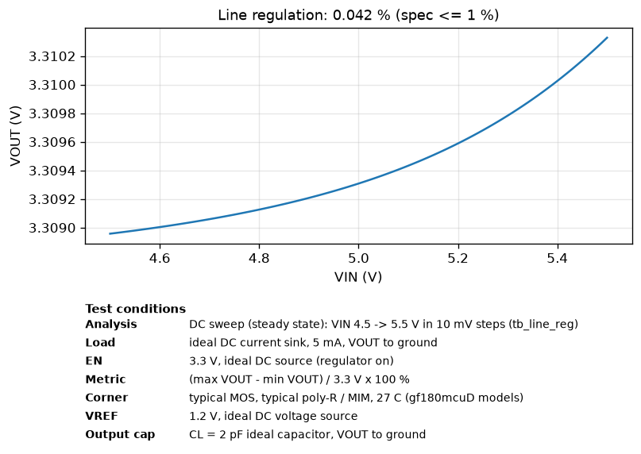
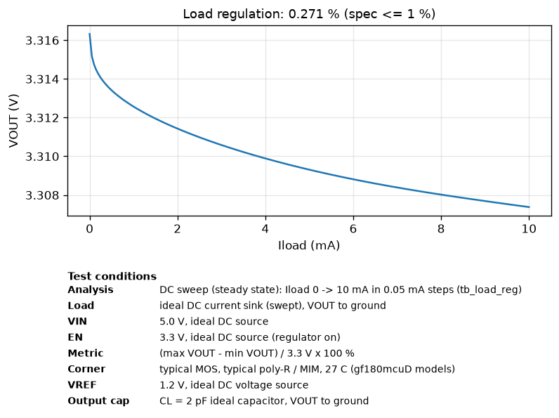
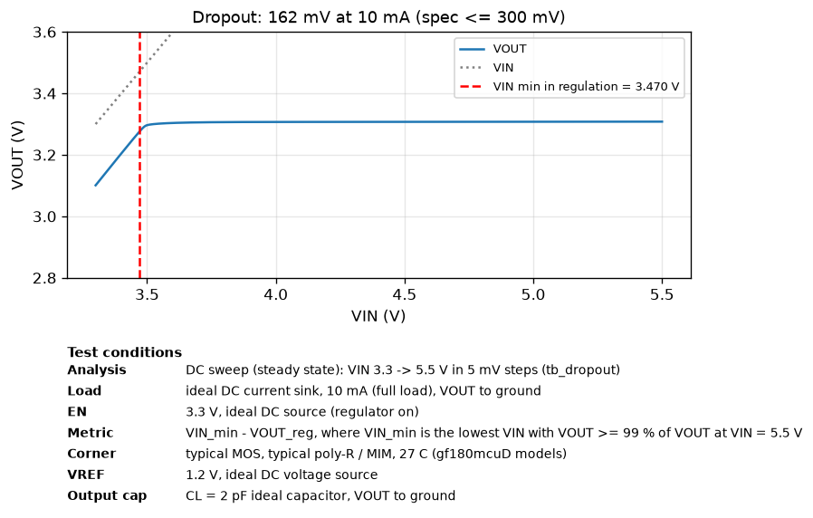
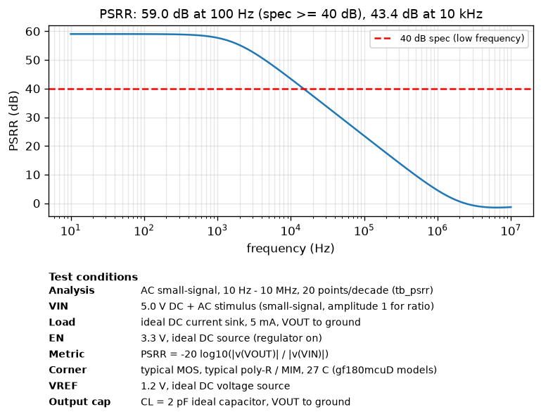
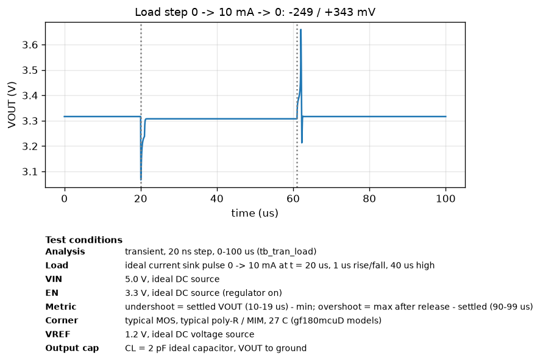
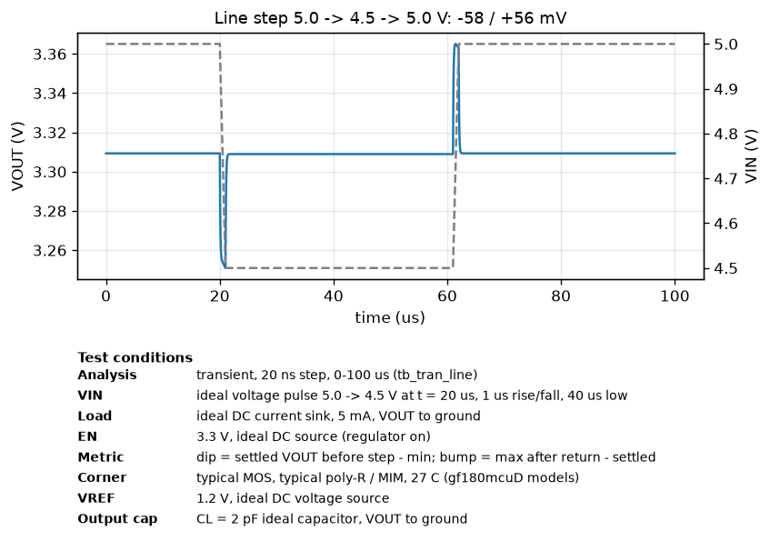
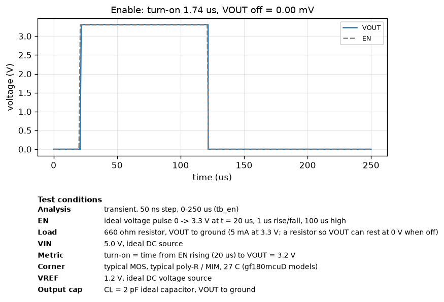
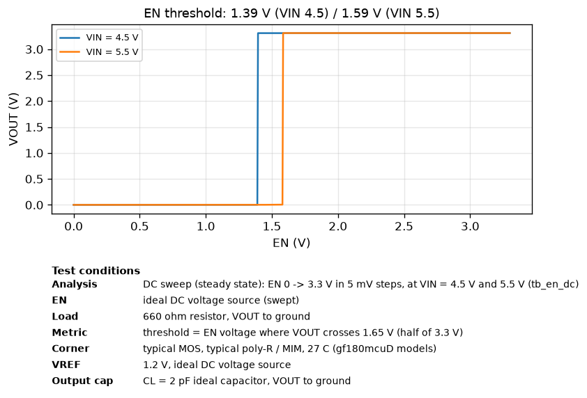
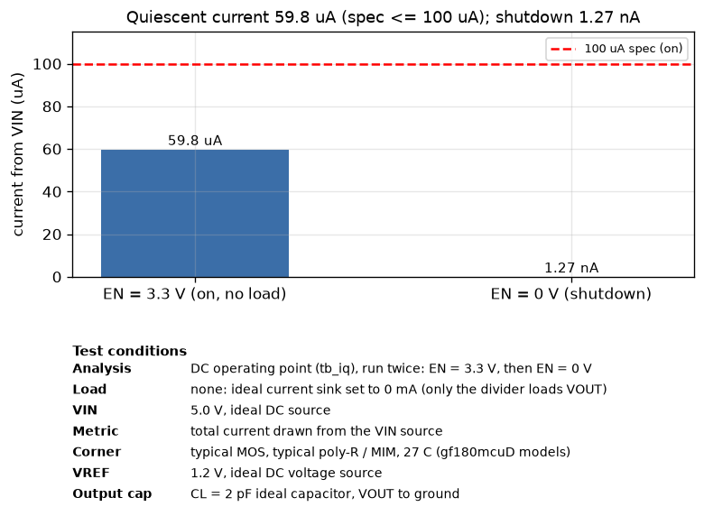

# Simulation results (post-layout, extracted RC netlist)

Generated by `simulations/run_sims.py`. Typical corner, 27 C, VIN = 5.0 V, VREF = 1.2 V,
EN = 3.3 V (harness logic level), CL = 2 pF, unless noted.

| Parameter | Spec | Simulated | Result | Testbench |
|---|---|---|---|---|
| Output voltage (5 mA) | 3.201 - 3.399 V | 3.3093 V | PASS | tb_load_reg |
| Dropout (10 mA) | <= 300 mV | 162 mV | PASS | tb_dropout |
| Quiescent current (no load) | <= 100 uA | 59.8 uA | PASS | tb_iq |
| Line regulation (4.5-5.5 V, 5 mA) | <= 1.0 % | 0.042 % | PASS | tb_line_reg |
| Load regulation (0-10 mA) | <= 1.0 % | 0.271 % | PASS | tb_load_reg |
| PSRR (100 Hz, 5 mA) | >= 40 dB | 59.0 dB | PASS | tb_psrr |
| PSRR (10 kHz / 1 MHz) | - | 43.4 / 4.5 dB | info | tb_psrr |
| Load step 0->10 mA, 1 us | - | -249 / +343 mV | info | tb_tran_load |
| Line step 5.0->4.5 V, 1 us | - | -58 / +56 mV | info | tb_tran_line |
| EN off -> VOUT | 0 V | 0.00 mV | PASS | tb_en |
| EN turn-on time (to 3.2 V) | - | 1.74 us | info | tb_en |
| EN switching threshold | 3.3 V logic | 1.39 / 1.59 V (VIN 4.5 / 5.5) | PASS | tb_en_dc |
| Shutdown current (EN = 0) | - | 1.27 nA | info | tb_iq |
| Test buffer FB_BUF (FB - FB_BUF) | follows FB | 0.442 V (0.764 V below FB = 1.206 V) | info | tb_iq |
| Test buffer EAOUT_BUF (EAOUT - EAOUT_BUF) | follows EAOUT | 2.908 V (1.331 V below EAOUT = 4.239 V) | info | tb_iq |

 
 
 
 

## Process corners x temperature (VIN = 5.0 V)

MOS corners tt/ff/ss/fs/sf x poly-resistor and MIM-capacitor corners typical/ff/ss x -40/27/110 C.
Each column uses the same testbench and load as the typical table above: VOUT at a 5 mA ideal current
sink (tb_load_reg), Iq and off current with no load (tb_iq), line reg at 5 mA, load reg 0-10 mA,
dropout at 10 mA, PSRR at 5 mA.

| MOS corner | R/C corner | Temp (C) | VOUT @5 mA (V) | Iq (uA) | Line reg (%) | Load reg (%) | Dropout @10 mA (mV) | PSRR @100 Hz (dB) | Off current, EN = 0 (nA) |
|---|---|---|---|---|---|---|---|---|---|
| typical | typical | -40 | 3.3092  | 55.0  | 0.033  | 0.208  | 117  | 61.2  | 1.27 |
| typical | typical | 27 | 3.3093  | 59.8  | 0.042  | 0.271  | 162  | 59.0  | 1.27 |
| typical | typical | 110 | 3.3097  | 64.8  | 0.050  | 0.382  | 217  | 57.3  | 1.50 |
| typical | ff | -40 | 3.3098  | 67.4  | 0.039  | 0.216  | 121  | 59.7  | 1.27 |
| typical | ff | 27 | 3.3103  | 73.3  | 0.048  | 0.287  | 166  | 57.7  | 1.27 |
| typical | ff | 110 | 3.3110  | 79.3  | 0.057  | 0.427  | 216  | 56.0  | 1.50 |
| typical | ss | -40 | 3.3087  | 46.7  | 0.029  | 0.203  | 117  | 62.5  | 1.27 |
| typical | ss | 27 | 3.3087  | 50.7  | 0.037  | 0.261  | 163  | 60.2  | 1.27 |
| typical | ss | 110 | 3.3088  | 54.9  | 0.044  | 0.357  | 218  | 58.4  | 1.50 |
| ff | typical | -40 | 3.3085  | 60.5  | 0.045  | 0.204  | 97  | 58.4  | 1.29 |
| ff | typical | 27 | 3.3088  | 65.6  | 0.056  | 0.277  | 132  | 56.4  | 1.31 |
| ff | typical | 110 | 3.3093  | 71.0  | 0.067  | 0.564  | 177  | 54.6  | 4.53 |
| ff | ff | -40 | 3.3093  | 73.8  | 0.051  | 0.214  | 97  | 57.1  | 1.29 |
| ff | ff | 27 | 3.3098  | 80.2  | 0.064  | 0.297  | 136  | 55.1  | 1.31 |
| ff | ff | 110 | 3.3107  | 86.8  | 0.077  | 0.751  | 181  | 53.3  | 4.53 |
| ff | ss | -40 | 3.3081  | 51.4  | 0.040  | 0.197  | 98  | 59.4  | 1.29 |
| ff | ss | 27 | 3.3082  | 55.7  | 0.050  | 0.263  | 133  | 57.4  | 1.31 |
| ff | ss | 110 | 3.3084  | 60.4  | 0.060  | 0.471  | 178  | 55.6  | 4.53 |
| ss | typical | -40 | 3.3099  | 51.1  | 0.021  | 0.220  | 151  | 65.9  | 1.26 |
| ss | typical | 27 | 3.3100  | 55.5  | 0.026  | 0.280  | 207  | 63.5  | 1.26 |
| ss | typical | 110 | 3.3102  | 60.1  | 0.031  | 0.367  | 272  | 61.7  | 1.29 |
| ss | ff | -40 | 3.3105  | 62.4  | 0.023  | 0.226  | 151  | 64.8  | 1.26 |
| ss | ff | 27 | 3.3108  | 67.8  | 0.028  | 0.292  | 206  | 62.8  | 1.26 |
| ss | ff | 110 | 3.3114  | 73.3  | 0.031  | 0.390  | 271  | 61.5  | 1.29 |
| ss | ss | -40 | 3.3095  | 43.4  | 0.018  | 0.216  | 152  | 67.1  | 1.26 |
| ss | ss | 27 | 3.3094  | 47.1  | 0.023  | 0.272  | 207  | 64.6  | 1.26 |
| ss | ss | 110 | 3.3094  | 50.9  | 0.028  | 0.352  | 273  | 62.6  | 1.29 |
| fs | typical | -40 | 3.3100  | 57.7  | 0.018  | 0.210  | 146  | 66.7  | 1.26 |
| fs | typical | 27 | 3.3103  | 62.8  | 0.024  | 0.271  | 201  | 63.9  | 1.27 |
| fs | typical | 110 | 3.3108  | 68.2  | 0.028  | 0.366  | 266  | 62.0  | 2.10 |
| fs | ff | -40 | 3.3108  | 70.7  | 0.022  | 0.218  | 146  | 64.7  | 1.26 |
| fs | ff | 27 | 3.3114  | 77.0  | 0.027  | 0.286  | 200  | 62.4  | 1.27 |
| fs | ff | 110 | 3.3123  | 83.4  | 0.032  | 0.402  | 260  | 60.9  | 2.10 |
| fs | ss | -40 | 3.3095  | 48.9  | 0.015  | 0.205  | 147  | 68.6  | 1.26 |
| fs | ss | 27 | 3.3096  | 53.3  | 0.020  | 0.261  | 202  | 65.4  | 1.27 |
| fs | ss | 110 | 3.3098  | 57.8  | 0.025  | 0.346  | 262  | 63.1  | 2.10 |
| sf | typical | -40 | 3.3085  | 53.1  | 0.052  | 0.212  | 97  | 57.0  | 1.28 |
| sf | typical | 27 | 3.3086  | 57.4  | 0.064  | 0.282  | 137  | 55.2  | 1.28 |
| sf | typical | 110 | 3.3089  | 62.0  | 0.076  | 0.433  | 183  | 53.6  | 1.92 |
| sf | ff | -40 | 3.3091  | 64.8  | 0.059  | 0.221  | 102  | 55.9  | 1.28 |
| sf | ff | 27 | 3.3095  | 70.2  | 0.071  | 0.299  | 137  | 54.2  | 1.28 |
| sf | ff | 110 | 3.3100  | 75.8  | 0.084  | 0.503  | 182  | 52.7  | 1.92 |
| sf | ss | -40 | 3.3081  | 45.1  | 0.047  | 0.207  | 98  | 57.9  | 1.28 |
| sf | ss | 27 | 3.3080  | 48.7  | 0.058  | 0.271  | 138  | 56.1  | 1.28 |
| sf | ss | 110 | 3.3081  | 52.6  | 0.069  | 0.396  | 183  | 54.5  | 1.92 |
